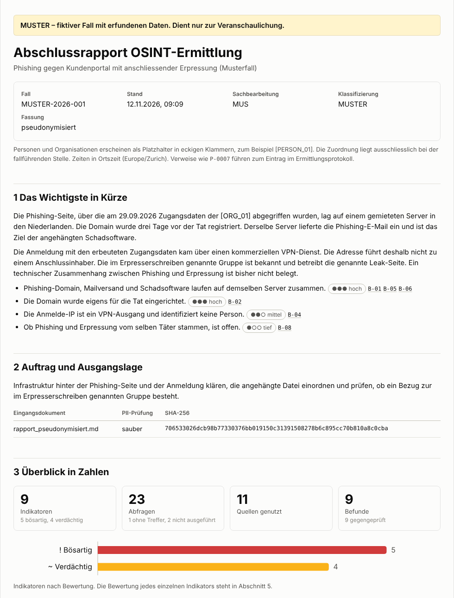
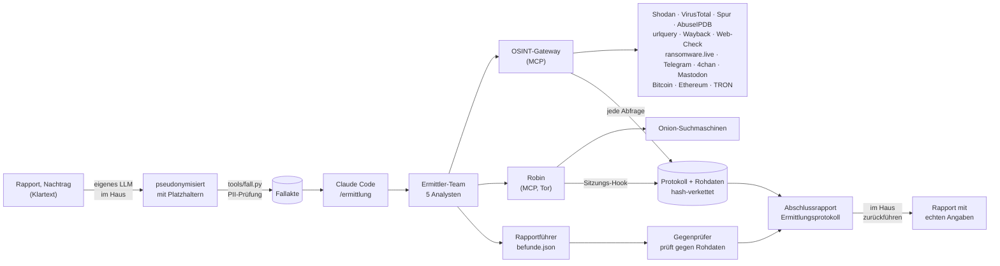
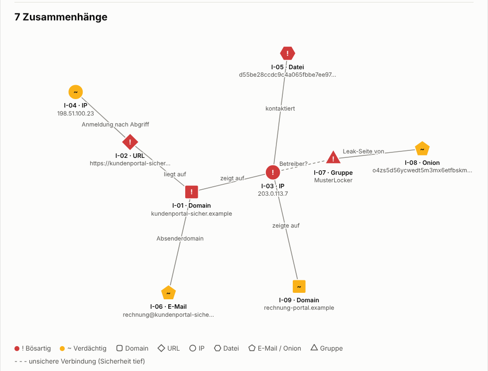
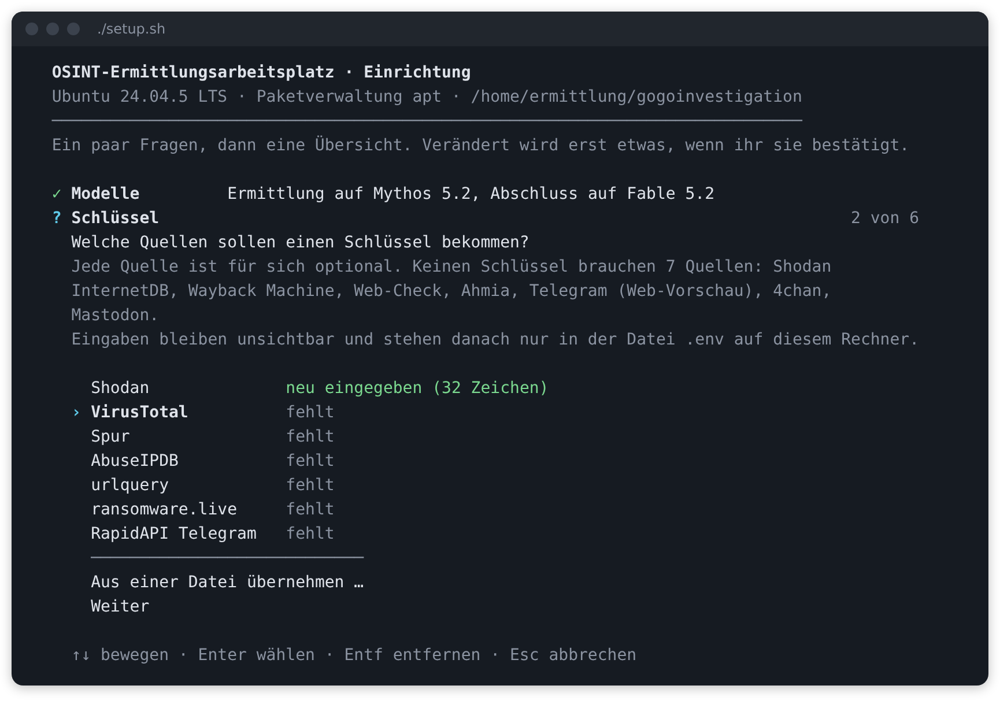
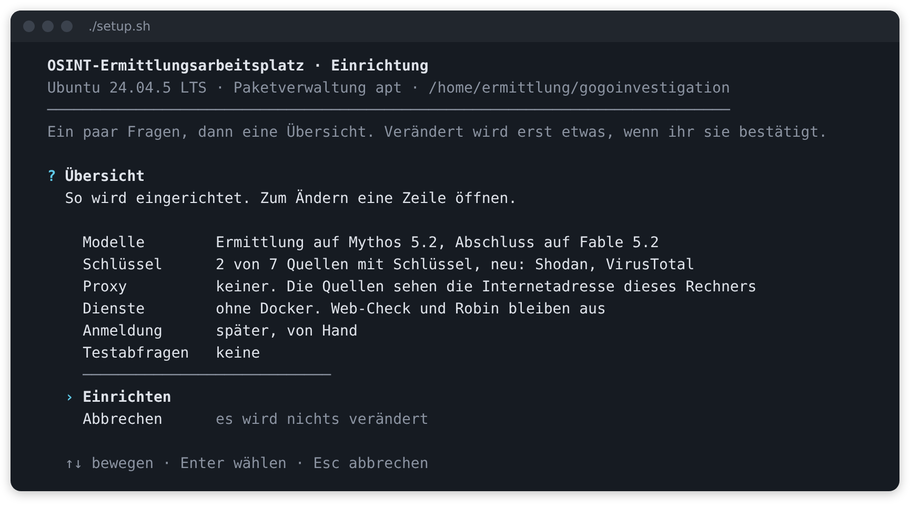
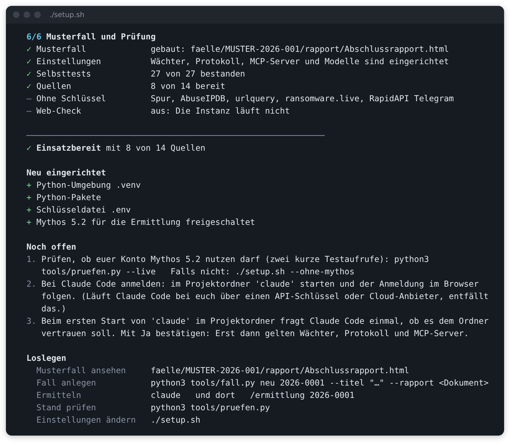
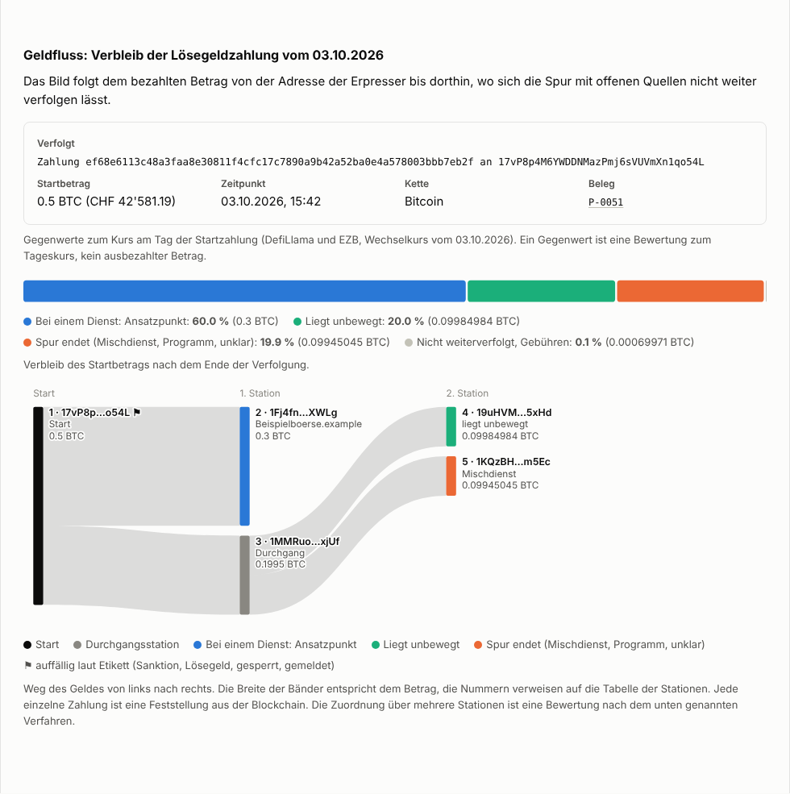

# gogoinvestigation

**Ein OSINT-Ermittlungsarbeitsplatz für Claude Code.** Ein pseudonymisierter Rapport geht hinein. Ein
Ermittler-Team aus KI-Agenten fragt Clearweb- und Dark-Web-Quellen ab, verfolgt Zahlungen in Kryptowährungen,
verknüpft die Ergebnisse und prüft sich gegenseitig. Heraus kommen ein verständlicher Abschlussrapport mit Diagrammen und ein lückenloses Protokoll
darüber, wann was wo und wozu abgefragt wurde.

> *English summary:* A Claude Code workspace for CTI and law-enforcement OSINT. One MCP gateway wraps Shodan,
> VirusTotal, Spur, AbuseIPDB, urlquery, Wayback Machine, Web-Check, ransomware.live, Telegram, 4chan and
> Mastodon, traces cryptocurrency payments on Bitcoin, Ethereum and TRON (multi-hop money flow, sanctions and
> exchange attribution, fiat value on the day), logs every request in a hash-chained audit trail and stores
> every raw response. A team of
> subagents investigates, an independent agent cross-checks every finding against the raw data, and a
> generator refuses to build the final report unless each statement is backed by evidence. Documentation is
> in German.



**Muster ansehen:** [Abschlussrapport (PDF, 19 Seiten)](muster/Abschlussrapport.pdf) ·
[Ermittlungsprotokoll (PDF, 19 Seiten)](muster/Ermittlungsprotokoll.pdf) ·
[was der Musterfall zeigt](muster/README.md). Der Fall ist frei erfunden.

## Inhalt

- [Was ihr bekommt](#was-ihr-bekommt)
- [Einrichten](#einrichten)
- [Schlüssel](#schlüssel)
- [Eine Ermittlung durchführen](#eine-ermittlung-durchführen)
- [Das Ermittler-Team](#das-ermittler-team)
- [Blockchain-Analyse](#blockchain-analyse)
- [Quellen](#quellen)
- [Schutzmechanismen](#schutzmechanismen)
- [Fehler beheben](#fehler-beheben)
- [Stand der Prüfung und Grenzen](#stand-der-prüfung-und-grenzen)
- [Erweitern](#erweitern)
- [Recht und Verantwortung](#recht-und-verantwortung)

## Was ihr bekommt



| Baustein | Aufgabe |
|---|---|
| **OSINT-Gateway** (`gateway/`) | Ein MCP-Server mit 43 Werkzeugen für alle Quellen. Protokolliert jede Abfrage, legt jede Antwort unverändert ab, hält Schlüssel aus Protokoll und Modell heraus, drosselt und cacht. |
| **Ermittler-Team** (`.claude/agents/`) | Sieben Subagenten: fünf Analysten, ein unabhängiger Gegenprüfer, ein Rapportführer. |
| **Blockchain-Analyse** (`gateway/krypto_*.py`) | Adressen prüfen und einordnen, Geldflüsse über mehrere Stationen verfolgen, Gegenwerte am Tag der Zahlung. Bitcoin, Ethereum und Verwandte, TRON samt USDT und USDC. Mehr unter [Blockchain-Analyse](#blockchain-analyse). |
| **Skills** (`.claude/skills/`) | Die Methodik: Ablauf der Ermittlung, Indikatoren ziehen, Ermittlungsstandard, Rapport, Protokoll. |
| **Wächter und Sitzungsprotokoll** (`.claude/hooks/`) | Sperren, was Agenten nicht dürfen, und halten fest, wer was getan hat und mit welchem Modell. |
| **Werkzeuge** (`tools/`) | Einrichten, Fall anlegen, PII-Prüfung, Rapport und Protokoll erzeugen, Kette prüfen, Einrichtung prüfen. |
| **Musterfall** (`faelle/MUSTER-2026-001/`, `muster/`) | Ein erfundener Fall, komplett durchgespielt. Zeigt, was am Ende in der Fallakte liegt. Rapport und Protokoll als PDF unter [`muster/`](muster/). |

Die Ergebnisse einer Ermittlung:

- `Abschlussrapport.html`: Zusammenfassung, Indikatoren, Befunde mit «Einfach erklärt», Beziehungsgraf, Geldfluss
  mit Flussbild, Zeitachse, Lücken, Empfehlungen, Glossar. Eine Datei, ohne Abhängigkeiten, aus dem Browser als PDF druckbar.
- `Ermittlungsprotokoll.html` und `.csv`: jede Abfrage mit Zeit, Quelle, Ziel, Zweck, Ergebnis, Prüfsumme, Rohdatei und Agent.
- `indikatoren.csv`: die Indikatorliste zum Weitergeben.
- Beide Dokumente als PDF im Format A4: `python3 tools/pdf.py <Fall-ID>`.



## Einrichten

Ein Befehl richtet den Arbeitsplatz ein. Im Terminal führt ein Assistent hindurch: Er fragt, was nur ihr wissen
könnt, zeigt eine Übersicht und verändert erst etwas, wenn ihr sie bestätigt. Danach läuft alles von selbst.
Der Befehl lässt sich beliebig oft wiederholen.

```bash
git clone https://github.com/valITino/gogoinvestigation.git
cd gogoinvestigation
./setup.sh              # Linux, macOS, WSL
```

```powershell
.\setup.cmd             # Windows: PowerShell oder Eingabeaufforderung
```



**Der Assistent**

Bedient wird er mit den Pfeiltasten und Enter, angekreuzt wird mit der Leertaste, Esc bricht ab. Jede Frage hat
eine Vorgabe: Wer nur Enter drückt, bekommt eine lauffähige Einrichtung ohne Mythos, ohne Schlüssel und ohne Proxy.

| Frage | Worum es geht |
|---|---|
| Installieren | Erscheint nur, wenn etwas fehlt (Claude Code, `pdftotext`, unter Windows Git for Windows). Nennt, was auf welchem Weg installiert würde. |
| Modelle | Darf euer Konto Claude Mythos 5.2 nutzen? Mit Ja schaltet die Ermittlung von selbst darauf um, siehe [Modelle je Phase](#modelle-je-phase). |
| Schlüssel | Liste der Quellen mit ihrem Stand. Eine Quelle öffnen und den Schlüssel einfügen. Die Eingabe bleibt unsichtbar, gezeigt wird nur die Zahl der Zeichen. Mit Entf wird ein Schlüssel entfernt. «Aus einer Datei übernehmen» liest eine vorbereitete Kopie von `.env.example`. |
| Proxy | Sollen die Abfragen an die Quellen über einen Proxy laufen? Kein Proxy, Tor auf diesem Rechner oder eine eigene Adresse. |
| Dienste | Web-Check und Robin über Docker. Fehlt Docker, bietet der Assistent unter Debian, Ubuntu und Kali die Installation an. Läuft es nur nicht, lässt sich nach dem Start erneut prüfen. |
| Anmeldung | Erscheint nur, wenn Claude Code noch nicht angemeldet ist. Auf Wunsch startet die Einrichtung am Ende die Anmeldung im Browser. |
| Testabfragen | Auf Wunsch geht am Ende je eingerichteter Quelle eine harmlose Abfrage hinaus. Das zeigt sofort, ob Schlüssel, Netz und Proxy stimmen. |

Am Schluss steht die Übersicht. Jede Zeile lässt sich öffnen und ändern. Erst «Einrichten» verändert etwas,
«Abbrechen» lässt alles, wie es war. Tasten, die vor einer Frage getippt wurden, zählen nicht, und die Übersicht
nimmt die erste halbe Sekunde keine Taste an: Ein doppelt gedrücktes Enter bestätigt nichts, was noch niemand
lesen konnte.



Schlüssel landen nur in der Datei `.env` auf eurem Rechner. Sie erscheinen weder auf dem Bildschirm noch in den
Meldungen der Einrichtung. Wer den Assistenten erst ansehen will: `./setup.sh --vorschau` stellt die Fragen,
zeigt die Übersicht und verändert nichts.

**Später etwas ändern.** Auf einem eingerichteten Arbeitsplatz bietet derselbe Befehl drei Wege an: «Prüfen und
auffrischen» (fragt nichts, die Einstellungen bleiben), «Einstellungen ändern» (führt direkt zur Übersicht) und
«Nur den Stand zeigen». So kommt ein neuer Schlüssel dazu, ein Proxy weg oder Mythos an.

**Ohne Rückfragen.** Ohne Terminal fragt die Einrichtung von selbst nichts, etwa in einem Skript, in einer
CI-Umgebung oder wenn die Ausgabe in eine Datei geht. Im Terminal erreicht das `--ohne-rueckfragen`. Dann
gelten die Optionen der Befehlszeile und die Werte aus `.env`, und Fehlendes wird ohne Nachfrage installiert.

**Wenn das Terminal nicht mitspielt.** `--schlicht` stellt dieselben Fragen als nummerierte Listen, ohne
Cursorsteuerung und ohne Laufanzeige. Das ist der Weg für Bildschirmleser und sehr alte Terminals. Farben
schaltet die Umgebungsvariable `NO_COLOR=1` ab. Keine Aussage hängt an der Farbe allein, jeder Zustand hat ein
Zeichen und ein Wort.

**Voraussetzungen und was die Einrichtung damit tut**

| Was | Wozu | Nötig? | Wenn es fehlt |
|---|---|---|---|
| Python 3.10 oder neuer | Gateway, Werkzeuge, Hooks | ja | wird installiert: über die Paketverwaltung des Systems (apt, dnf, yum, pacman, zypper, apk, Homebrew), unter Windows über winget. Im Terminal fragt das Startskript vorher. |
| `venv` und `pip` | eigene Python-Umgebung `.venv` im Projektordner | ja | wird installiert (Debian, Ubuntu, Kali: Paket `python3-venv`) |
| [Claude Code](https://code.claude.com/docs) ab 2.1.295 | die Agenten | ja | wird mit dem Installer von Anthropic installiert |
| Git for Windows, nur unter Windows | Git Bash. Darin führt Claude Code Wächter und Protokoll aus. | ja | wird über winget installiert |
| `pdftotext` (Poppler) | Rapporte als PDF aufnehmen | nein, `.txt` `.md` `.docx` gehen ohne | wird installiert |
| Docker | Web-Check und Robin (Dark Web) | nein, beides bleibt sonst aus | wird gemeldet. Debian, Ubuntu, Kali: `./setup.sh --docker-installieren` holt es nach |
| Chrome, Chromium, Edge oder Brave | Rapport und Protokoll als PDF erzeugen | nein, sonst im Browser als PDF drucken | wird gemeldet |
| Konto für Claude Code | Anmeldung, Zugang zu Fable 5.2 | ja | bleibt bei euch |

«Wird installiert» heisst im Assistenten: nach eurem Ja auf die Frage «Installieren». Ohne Rückfragen
geschieht es von selbst, es sei denn, ihr gebt `--nichts-installieren` mit.

Systempakete brauchen unter Linux root. Läuft die Einrichtung nicht als root, fragt `sudo` einmal nach dem
Passwort. Alles andere landet im Projektordner oder im eigenen Benutzerkonto. Unter Windows kommt die
Einrichtung in der Regel ohne Administratorrechte aus. Fehlt Git for Windows, kann dessen Installation danach fragen.

**Die sechs Schritte** nach der Bestätigung

1. Voraussetzungen prüfen und Fehlendes installieren.
2. `.venv` anlegen und die Pakete installieren.
3. `.env` aus `.env.example` anlegen, nur für das eigene Konto lesbar, und eure Antworten eintragen.
   Eine vorhandene `.env` bleibt, geändert wird nur, was ihr geändert habt.
4. Web-Check per Docker auf `127.0.0.1:3000` starten und das Robin-Abbild laden, falls Docker läuft.
5. Claude Code: MCP-Server freischalten, Mythos freischalten, wenn ihr es erklärt habt
   (`.claude/settings.local.json`), Anmeldung prüfen.
6. Musterfall bauen und die Einrichtung mit 36 Selbsttests prüfen.

Auf Wunsch folgen die Anmeldung bei Claude Code und die Testabfragen. Während längerer Arbeiten läuft eine
Zeile mit, die sagt, was gerade geschieht. Am Ende steht, ob der Arbeitsplatz einsatzbereit ist, was neu
eingerichtet wurde und was für euch bleibt.



Die Prüfung erscheint hier als Kurzfassung, jeder Fehler steht einzeln da. Ausführlich zeigt sie
`python3 tools/pruefen.py`. Die Meldungen der Installationsprogramme liegen im Ordner `osint-setup` des
temporären Verzeichnisses (`/tmp/osint-setup`, unter Windows `%TEMP%\osint-setup`).

**Optionen**

Alles, was der Assistent fragt, lässt sich auch als Option mitgeben. Im Assistenten sind die Optionen die
Vorgaben der Fragen. Auf einem schon eingerichteten Arbeitsplatz fragt die Einrichtung nicht nach, wenn eine
Option etwas einstellt: `./setup.sh --mythos` schaltet Mythos frei und ist fertig.

| Option | Wirkung |
|---|---|
| `--ohne-rueckfragen` | fragt nichts. Kurz: `--ja` oder `-y` |
| `--vorschau` | stellt die Fragen und zeigt die Übersicht, verändert aber nichts |
| `--schlicht` | Fragen als nummerierte Listen, ohne Cursorsteuerung und ohne Laufanzeige |
| `--nur-pruefen` | zeigt, was vorhanden ist und was fehlt. Verändert nichts. |
| `--nichts-installieren` | installiert nichts am System, richtet nur das Projekt ein |
| `--mythos` | erklärt: Dieses Konto hat Claude Mythos 5.2. Die Ermittlung schaltet dann von selbst darauf um, siehe [Modelle je Phase](#modelle-je-phase). Zurücknehmen: `--ohne-mythos` |
| `--env-von DATEI` | übernimmt Schlüssel und Einstellungen aus einer vorbereiteten Datei nach `.env` |
| `--docker-installieren` | installiert Docker aus den Paketquellen mit (Debian, Ubuntu, Kali) |
| `--ohne-docker`, `--ohne-webcheck`, `--ohne-robin` | lässt Web-Check und Robin aus, oder nur eines von beiden |
| `--testen` | schickt am Ende je eingerichteter Quelle eine harmlose Testabfrage |
| `--hilfe` | alle Optionen |

**Mehrere Arbeitsplätze.** Eine ausgefüllte Kopie von `.env.example` an einem geschützten Ort ablegen, auf
Wunsch mit `OSINT_MYTHOS=ja`. Dann genügt je Laptop ein Befehl, und niemand muss etwas beantworten:

```powershell
.\setup.cmd --ohne-rueckfragen --env-von \\server\freigabe\osint.env
```

**Was von Hand bleibt** und sich bewusst nicht automatisieren lässt:

- Schlüssel bei den Anbietern besorgen, siehe [Schlüssel](#schlüssel). Eintragen kann sie der Assistent.
- Bei Claude Code anmelden. Der Assistent startet die Anmeldung auf Wunsch, durch den Browser geht ihr selbst.
  Sonst: `claude` starten und der Anmeldung folgen.
- Beim ersten Start von `claude` im Projektordner den Vertrauensdialog bestätigen. Erst dann gelten Wächter,
  Protokoll und MCP-Server.

**Kontrolle**

```bash
python3 tools/pruefen.py          # Umgebung, Konfiguration, Modelle, Quellen, alle Selbsttests einzeln
python3 tools/pruefen.py --live   # zusätzlich eine harmlose Testabfrage je eingerichteter Quelle
claude mcp list                   # zeigt "osint … Connected", sobald der Ordner als vertrauenswürdig bestätigt ist
```

### Windows

Zwei Wege führen zum selben Arbeitsplatz. Nicht mischen: Je System braucht es einen eigenen Klon, denn die
Python-Umgebungen von Linux und Windows vertragen sich nicht im selben Ordner. Die Einrichtung erkennt das und
bricht mit einem Hinweis ab.

| Weg | So | Docker |
|---|---|---|
| **WSL** | Repository in WSL klonen, dort `./setup.sh`. Es gilt alles, was für Linux gilt. | freie Docker Engine: `./setup.sh --docker-installieren` |
| **Windows direkt** | `.\setup.cmd` in PowerShell oder der Eingabeaufforderung | Docker Desktop, von Hand |

Für Windows direkt gilt:

- **Der Interpreter heisst `python`**, nicht `python3`. Sonst sind alle Befehle dieser Anleitung gleich:
  `python tools\fall.py neu 2026-0412 …`.
- **`setup.cmd` startet `setup.ps1`** mit `-ExecutionPolicy Bypass` für genau diesen einen Lauf. Die Richtlinie
  des Rechners bleibt, wie sie ist. Sperrt eine Gruppenrichtlinie PowerShell-Skripte ganz, leistet
  `py tools\einrichten.py` dasselbe, sobald Python installiert ist.
- **Der Assistent läuft in Windows Terminal, in PowerShell und in der Eingabeaufforderung.** Im alten
  Konsolenfenster erscheinen schlichtere Zeichen (`>` statt `›`, `ok` statt `✓`), weil dessen Schrift die
  anderen nicht kennt. Einen Schlüssel fügt ihr dort mit einem Rechtsklick ein, Strg+V kommt in diesem Fenster
  nicht immer an. In Git Bash startet die Einrichtung nicht.
- **Nach der Einrichtung ein neues Terminal öffnen.** Die Einrichtung setzt für euer Benutzerkonto die
  Umgebungsvariable `OSINT_PYTHON`. Über sie startet Claude Code das Gateway, weil es unter Windows kein
  `python3` gibt. Ein schon offenes Fenster kennt die Variable noch nicht.
- **Freigaben in PowerShell oder der Eingabeaufforderung erteilen**, nicht im Fenster von Git Bash. Dort
  erkennt Python kein Terminal und lehnt die Bestätigung ab.
- **Docker Desktop installiert die Einrichtung nicht.** Laut Docker brauchen grössere Unternehmen und Behörden
  dafür ein bezahltes Abonnement ([Bedingungen](https://docs.docker.com/desktop/setup/install/windows-install/)).
  Ohne Docker bleiben nur Web-Check und Robin aus.
- **Befehle laufen in Git Bash.** Das Projekt schaltet das PowerShell-Werkzeug von Claude Code ab
  (`CLAUDE_CODE_USE_POWERSHELL_TOOL=0`), damit Wächter und Berechtigungen an einer Stelle greifen. Der Wächter
  prüft PowerShell-Befehle trotzdem wie Bash, falls das Werkzeug doch aktiv ist.

## Schlüssel

Alle Schlüssel stehen in `.env`. Eintragen kann sie der Assistent der Einrichtung (`./setup.sh`, auf einem
eingerichteten Arbeitsplatz «Einstellungen ändern»), von Hand in der Datei geht es genauso. Jede Quelle ist für
sich optional: Was keinen Schlüssel hat, bleibt aus, der Rest läuft. Elf Quellen brauchen gar keinen, eine
davon (Web-Check) braucht Docker. Die Blockchain-Analyse läuft für Bitcoin, Ethereum und TRON ohne Schlüssel.

| Quelle | Variable in `.env` | Woher | Hinweis |
|---|---|---|---|
| Shodan | `SHODAN_API_KEY` | [account.shodan.io](https://account.shodan.io) | DNS-Abfragen und Trefferlisten der Suche verbrauchen Query-Credits. |
| VirusTotal | `VIRUSTOTAL_API_KEY` | [virustotal.com/gui/my-apikey](https://www.virustotal.com/gui/my-apikey) | Bedingungen des öffentlichen Schlüssels prüfen. Die Drossel ist auf ihn eingestellt (`VT_INTERVALL=15.5`), mit Premium auf `0` setzen. |
| Spur | `SPUR_TOKEN` | Spur-App, Settings → API ([Doku](https://docs.spur.us/context-api)) | Kommerzieller Dienst. |
| AbuseIPDB | `ABUSEIPDB_API_KEY` | [abuseipdb.com/account/api](https://www.abuseipdb.com/account/api) | |
| urlquery | `URLQUERY_API_KEY` | Konto auf [urlquery.net](https://urlquery.net) | |
| ransomware.live | `RANSOMWARE_LIVE_API_KEY` | [my.ransomware.live](https://my.ransomware.live) | API PRO. Die schlüssellose API v2 ist laut Anbieter nur für private Nutzung, darum hier nur mit `RANSOMWARE_LIVE_V2=1`. |
| Telegram über RapidAPI | `RAPIDAPI_KEY` | [rapidapi.com](https://rapidapi.com), APIs «Telegram Channel» und «Telegram Scraper API» abonnieren | Nur für Kanal-Stammdaten und Kontoabfragen. Drittanbieter unbekannter Herkunft, vor dem Einsatz prüfen. |
| TRON (TronGrid) | `TRONGRID_API_KEY` | [trongrid.io](https://www.trongrid.io), kostenlos | TRON läuft auch ohne, dann stark gedrosselt. Für Geldflüsse über viele Stationen lohnt sich der Schlüssel. |
| Etherscan | `ETHERSCAN_API_KEY` | [etherscan.io/apidashboard](https://etherscan.io/apidashboard), kostenlos | Weitere Ketten (Polygon, Arbitrum, Gnosis) und die Gegenprüfung von Ethereum-Transaktionen. BNB Smart Chain, Base und Optimism verlangen dort ein bezahltes Abo. |
| Tronscan | `TRONSCAN_API_KEY` | [Anleitung von Tronscan](https://docs.tronscan.org/getting-started/api-keys), kostenlos | Namen von Börsen und Diensten für TRON-Adressen. Ohne ihn endet eine Verfolgung auf TRON bei «Sammeladresse, Dienst unbekannt». |
| Chainabuse | `CHAINABUSE_API_KEY` | Profil auf [chainabuse.com](https://www.chainabuse.com) | Betrugsmeldungen Geschädigter. Das kostenlose Kontingent ist sehr klein, gefragt wird nur auf ausdrücklichen Wunsch. |
| Iknaio GraphSense | `IKNAIO_API_KEY` | [ikna.io](https://www.ikna.io), Zugang für Behörden auf Anfrage | Etiketten und Cluster für Bitcoin, Ethereum, TRON. |
| Shodan InternetDB, Wayback Machine, Ahmia-Sperrliste, Telegram-Kanalvorschau, 4chan, Mastodon | keine | | Laufen sofort. |
| Bitcoin (mempool.space), Ethereum (Blockscout), Krypto-Zuordnung (OFAC, TRM Labs, Ransomwhere, WalletExplorer), Krypto-Kurse (DefiLlama, EZB) | keine | | Laufen sofort. |
| Web-Check | keine | eigene Instanz, die Einrichtung startet sie | Adresse in `WEBCHECK_URL`. |
| Robin (Dark Web) | keine | Docker-Abbild, die Einrichtung lädt es | Tor läuft im Container. Eigener Fork: `ROBIN_IMAGE` setzen. |

Weitere Einstellungen in `.env`: `OSINT_PROXY` (alle Abfragen über einen Proxy leiten, damit sie nicht auf eure
Adresse zurückführen), `OSINT_ZEITZONE`, `OSINT_USER_AGENT`, `OSINT_MYTHOS`, und für eigene Instanzen der
Block-Explorer `KRYPTO_BITCOIN_API`, `KRYPTO_ETHEREUM_API` (je Kette), `KRYPTO_TRON_API`.

Die Schlüssel liest nur das Gateway. Claude Code darf `.env` nicht lesen, und im Protokoll erscheinen
Schlüssel als `***`.

## Eine Ermittlung durchführen

**1. Pseudonymisieren, im Haus.** Euer eigenes LLM ersetzt Personendaten durch nummerierte Platzhalter:
`[PERSON_01]`, `[ORG_01]`, `[ADRESSE_01]`, `[TEL_01]`. Nummeriert, nicht alle «Hans Muster», sonst geht verloren,
wer wer ist. Technische Indikatoren (IPs, Domains, Hashes, Adressen der Täterseite) bleiben stehen, denn nach
ihnen wird gesucht. Eine fertige Anweisung für euer LLM und die Regeln, was bleibt und was geht, stehen in
[docs/PSEUDONYMISIERUNG.md](docs/PSEUDONYMISIERUNG.md).

**2. Ermitteln.** Ein Befehl in Claude Code:

```
claude
/ermittlung 2026-0412 ~/eingang/rapport_pseudonymisiert.docx
```

Das legt den Fall an, schickt das Dokument durch die PII-Prüfung, zieht die Indikatoren, setzt das Team ein,
lässt gegenprüfen und erzeugt Rapport und Protokoll. Rückfragen gibt es nur, wo ein Mensch entscheiden muss.

Wer den Fall lieber selbst anlegt:

```bash
python3 tools/fall.py neu 2026-0412 --titel "Phishing Kundenportal" --kuerzel ABC --rapport rapport.docx
```

**3. Freigaben erteilen, falls nötig.** Drei Dinge sind standardmässig aus und werden pro Fall am Terminal freigegeben:

```bash
python3 tools/fall.py freigabe 2026-0412 darkweb       --durch "Kürzel/Funktion" --vermerk "Grundlage"
python3 tools/fall.py freigabe 2026-0412 aktiv         --durch "…" --vermerk "…"
python3 tools/fall.py freigabe 2026-0412 personenbezug --durch "…" --vermerk "…"
```

| Freigabe | Schaltet frei |
|---|---|
| `darkweb` | Suche und Lektüre von Onion-Seiten über Robin. |
| `aktiv` | Massnahmen, die das Ziel bemerken kann: URL bei urlquery einreichen, Seite in der Wayback Machine sichern, aktive Web-Check-Prüfungen. Jede einzelne verlangt zusätzlich eine Bestätigung in der Sitzung. |
| `personenbezug` | Kontoabfragen: Mastodon-Konto, Telegram-Benutzer und -Suche. |

Der Befehl verlangt eine Bestätigung am Terminal. Ein Agent kann sich keine Freigabe selbst erteilen.

**4. Ergebnis ansehen.** `faelle/2026-0412/rapport/Abschlussrapport.html` im Browser öffnen. Als PDF:

```bash
python3 tools/pdf.py 2026-0412
```

**5. Zurückführen, im Haus.** Die Platzhalter im fertigen Rapport ersetzt ihr ausserhalb von Claude Code:

```bash
python3 tools/reidentifizieren.py 2026-0412 --zuordnung /sicher/zuordnung.csv --ausgabe /sicher/ablage/
```

Weitere Befehle:

```bash
python3 tools/fall.py liste                    # alle Fälle
python3 tools/fall.py status 2026-0412         # Stand und Freigaben
python3 tools/fall.py aufnehmen 2026-0412 nachtrag.docx
python3 tools/rapport.py 2026-0412             # Rapport neu erzeugen (--entwurf, --nur-pruefen)
python3 tools/protokoll.py 2026-0412           # Protokoll neu erzeugen
python3 tools/pdf.py 2026-0412                 # beide Dokumente als PDF (A4)
python3 tools/audit_pruefen.py 2026-0412       # Protokollkette prüfen
python3 tools/musterfall.py                    # Musterfall neu bauen
```

In Claude Code: `/ermittlung <Fall-ID> [Dokument]`, `/abschlussrapport <Fall-ID>`, `/protokoll <Fall-ID>`.

## Das Ermittler-Team

| Agent | Fragt | Werkzeuge |
|---|---|---|
| `infrastruktur-analyst` | Wem gehört die IP? Rechenzentrum, VPN oder Privatanschluss? Was läuft darauf, was lag sonst dort? | Shodan, Spur, AbuseIPDB, VirusTotal, Web-Check passiv, Wayback |
| `malware-url-analyst` | Ist die Datei bekannt? Was tat die Seite beim Aufruf? Seit wann gibt es sie? | VirusTotal, urlquery, Wayback, Web-Check passiv |
| `darkweb-analyst` | Ist die Gruppe bekannt? Passt die Leak-Seite? Taucht der Fall in Breach-Feeds oder im Dark Web auf? | ransomware.live, Ahmia-Sperrliste, Telegram, Robin |
| `socmint-analyst` | Was wird in Foren und Kanälen zum Fall gesagt? Was zeigen Konten der Täterseite? | 4chan, Telegram, Mastodon |
| `blockchain-analyst` | Stimmt die Zahlung? Wohin ging das Geld? Bei welcher Börse lässt sich ansetzen, wo liegt noch Guthaben? | Bitcoin, Ethereum und Verwandte, TRON: Explorer, Sanktionslisten, Etiketten, Kurse |
| `gegenpruefer` | Steht das, was im Rapport stehen soll, wirklich in den Rohdaten? | nur Lesen. Kennt den Ermittlungsverlauf nicht. |
| `rapportfuehrer` | Verdichtet die Meldungen zu `befunde.json`, arbeitet die Gegenprüfung ein, erzeugt Rapport und Protokoll. | Lesen, Schreiben, `tools/` |

Die Hauptsitzung leitet: Sie zieht die Indikatoren, verteilt sie, entscheidet über Pivots (höchstens zwei Runden)
und ist die einzige, die aktive Massnahmen ausführt.

### Modelle je Phase

Zwei Modelle teilen sich die Arbeit. Die Zuteilung steht fest in den Dateien des Projekts und ist für alle gleich:

| Phase | Wer | Verlangt |
|---|---|---|
| **Ermittlung** | `/ermittlung` (Leitung, Indikatoren, Pivots, aktive Massnahmen) und die fünf Analysten | `claude-mythos-5-2` |
| **Abschluss** | `gegenpruefer`, `rapportfuehrer` (Befunde, Rapport, Übergabe), `/abschlussrapport`, `/protokoll` | `claude-fable-5-2` |
| alles andere | die Sitzung vor und nach der Ermittlung, etwa Rückfragen zum Rapport | `claude-fable-5-2` |

Ob die Ermittlung tatsächlich auf Mythos läuft, hängt an einer einzigen Angabe.

**Ohne Angabe läuft alles auf Fable 5.2.** Das Projekt lässt in `.claude/settings.json` nur dieses Modell zu
(`availableModels`). Verlangt ein Skill oder Agent ein Modell ausserhalb der Liste, übergeht Claude Code den
Wunsch und nimmt das Modell der Sitzung. So funktioniert das Repository für alle, ohne dass jemand etwas ändert.

**Wer Mythos 5.2 hat, erklärt das einmal:**

```bash
./setup.sh --mythos          # Windows: .\setup.cmd --mythos        zurücknehmen: --ohne-mythos
```

oder mit `OSINT_MYTHOS=ja` in `.env`. Die Einrichtung trägt Mythos in die lokale Liste ein
(`.claude/settings.local.json`, nicht eingecheckt), und Claude Code fügt beide Listen zusammen. Von da an gilt
bei jeder Ermittlung, ohne Umstellen von Hand:

1. `/ermittlung` schaltet die Sitzung auf Mythos 5.2. Die Analysten laufen auf Mythos 5.2.
2. Gegenprüfung, Befunde, Rapport, Protokoll und Übergabe laufen auf Fable 5.2.
3. Mit eurer nächsten Eingabe ist die Sitzung wieder auf Fable 5.2.

Mythos 5.2 ist dasselbe Modell wie Fable 5.2, ohne dessen zusätzliche Schutzmassnahmen für Cybersicherheit und
Biologie, und steht nur Organisationen offen, die Anthropic verifiziert hat
([Modellseite](https://platform.claude.com/docs/en/models/mythos-5-2/overview)). Ob euer Konto es nutzen darf,
zeigt `python3 tools/pruefen.py --live` mit einem kurzen Testaufruf je Modell. Ist Mythos freigeschaltet, das Konto
aber ohne Zugang, bricht `/ermittlung` gleich beim Start mit der Meldung von Claude Code ab. Dann `--ohne-mythos`.

Gut zu wissen:

- **Die Umschaltung von `/ermittlung` gilt bis zu eurer nächsten Eingabe.** Beantwortet ihr mitten in der
  Ermittlung eine Rückfrage, leitet danach wieder Fable 5.2. Die Analysten laufen weiter auf Mythos.
- **Ohne Mythos meldet Claude Code beim Start jedes Analysten**, dass statt des verlangten Modells das der Sitzung
  läuft. Das ist der Normalfall und kein Fehler.
- **Die Liste gilt für den ganzen Projektordner.** Mit `/model` lässt sich hier nur wählen, was zugelassen ist.
  Wer weitere Modelle will, ergänzt `availableModels` in den eigenen Einstellungen (`~/.claude/settings.json`).
  Legt eure Organisation die Liste zentral fest (verwaltete Einstellungen), gilt allein deren Liste.
- **Grafiken zeichnet kein Modell.** Die Texte des Rapports und die Daten für Beziehungsgraf und Zeitachse schreibt
  der Rapportführer in `befunde.json`. Die Grafiken zeichnet `tools/rapport.py` daraus als Programm. Bei gleichen
  Befunden fallen sie deshalb immer gleich aus.

**Nachsehen, was tatsächlich lief.** Das Sitzungsprotokoll hält fest, welches Modell die Hauptsitzung und jeder
Subagent benutzt hat, gelesen aus den Transkripten von Claude Code. Das Ermittlungsprotokoll zeigt es unter
«Sitzungsverlauf» als Zeile «Eingesetzte Sprachmodelle», ebenso jeden Wechsel mit `/model`. Während der Arbeit
zeigt `/tasks` das Modell jedes laufenden Subagenten.

Die geltende Zuteilung zeigt `python3 tools/pruefen.py` unter «Konfiguration». Selbsttests schlagen an, wenn ein
Agent des Abschlusses nicht auf Fable 5.2 steht oder das Projekt Mythos von sich aus zuliesse. Wie Claude Code
Modelle ausserhalb der Liste behandelt, steht in dessen Dokumentation:
[Modelle einschränken](https://code.claude.com/docs/en/model-config),
[Modell eines Subagenten](https://code.claude.com/docs/en/sub-agents).

Skills und Subagenten ergänzen sich: Ein **Subagent** ist eine Rolle mit eigenem Kontext und eigenen Werkzeugen.
Ein **Skill** ist Wissen, wie etwas zu tun ist. Der Skill `ermittlungsstandard` wird in jeden Analysten vorgeladen
und regelt Zweckangabe, Sicherheitsstufen, Quellenbewertung und das Format der Rückmeldung.

## Blockchain-Analyse

Für Fälle, in denen Geld in Kryptowährungen floss: Online-Anlagebetrug, Lösegeld, Zahlungen an Betrüger. Eine
Blockchain ist ein öffentliches Kassenbuch. Jede Zahlung steht für immer darin, aber ohne Namen. Namen kennt nur,
wer Kunden hat: Börsen und Zahlungsdienste. Die Analyse folgt deshalb dem Geld bis zu der Stelle, an der es bei
einem solchen Dienst ankommt, und nennt, was die fallführende Stelle dort verlangen kann.



| Frage | Werkzeug |
|---|---|
| Ist die Adresse richtig abgeschrieben? Welche Kette ist es? | `krypto_adresse_pruefen` prüft Format und Prüfsumme, ohne etwas abzufragen. Ein vertauschtes Zeichen fällt auf, bevor eine falsche Adresse in einen Rapport gerät. |
| Was liegt auf der Adresse, was lief darüber, wer hat sie zuerst finanziert? | `krypto_adresse` |
| Welche Zahlungen gingen ein und aus, mit wem? | `krypto_transaktionen`. Köderzahlungen über null und Token mit dem Namen einer bekannten Währung, aber fremdem Vertrag, sind gekennzeichnet. |
| Stimmt die Zahlung des Geschädigten? Betrag, Zeit, Empfänger, Gegenwert in Franken am Tag der Zahlung | `krypto_transaktion`, auf Wunsch mit Gegenprüfung bei einer zweiten Quelle |
| Wohin ging das Geld? | `krypto_geldfluss` folgt einer Zahlung über mehrere Stationen |
| Wem lässt sich eine Adresse zuordnen? | `krypto_zuordnung`: Sanktionslisten, bekannte Lösegeld-Adressen, Etiketten von Börsen, gesperrte Adressen |
| Was war ein Betrag am Stichtag wert? | `krypto_kurs` in CHF, EUR und USD |

**Was abgedeckt ist**

| Kette | Ohne Schlüssel | Mit Schlüssel |
|---|---|---|
| Bitcoin | mempool.space, bei Störung Blockstream. Zuordnung über OFAC, TRM Labs, Ransomwhere, WalletExplorer. | Iknaio: Etiketten und Cluster |
| Ethereum, Optimism | Blockscout: ETH, USDT, USDC und jeder andere Token, Etiketten von Börsen und Brücken | Etherscan: Gegenprüfung von Transaktionen |
| Polygon, Arbitrum, Gnosis, Base | Blockscout, sofern es den Anschluss zulässt. Aus Rechenzentren weist es diese Ketten oft ab. | Etherscan (Base nur mit bezahltem Abo) |
| BNB Smart Chain | nicht abfragbar | Etherscan mit bezahltem Abo |
| TRON | TronGrid: TRX, USDT, USDC und jeder andere Token, Sperrliste von Tether. Gedrosselt. | TronGrid: ohne Drossel. Tronscan: Namen von Börsen und Diensten |
| Monero, Litecoin, Bitcoin Cash, Dogecoin, Solana | werden erkannt und als nicht abfragbar gemeldet. Monero lässt sich grundsätzlich nicht verfolgen. | |

**So folgt das Werkzeug dem Geld.** Ausgangspunkt ist eine Zahlung (die Transaktions-ID aus dem Rapport) oder eine
Adresse (dann alles, was sie verlassen hat). Von dort geht es Station um Station weiter, bis das Geld an einem
dieser Enden ankommt:

| Ende | Bedeutung |
|---|---|
| Bei einem Dienst | Die Adresse gehört laut Etikett einer Börse, einem Zahlungsdienst oder einem Verwahrer. Dort ist ein Editionsbegehren möglich. Massgebend ist die Kategorie, die die Quelle vergibt. Ein Name allein genügt nicht: Namen tragen auch Adressen von Tätern und von Sanktionierten. |
| Sammelbewegung | Muster eines Dienstes, der Kundengelder zusammenlegt. Der Name ist nicht bekannt. |
| Liegt unbewegt | Der Betrag wurde seit dem Eingang nicht weitergeleitet. Bei USDT und USDC kann der Emittent ihn sperren. |
| Mischdienst | Adresse eines Mischdienstes laut Etikett, oder Transaktion mit dessen Muster. Dahinter ist keine belastbare Zuordnung möglich. |
| Programm auf der Kette | Tauschbörse oder Brücke. Was dort geschah, zeigen die genutzten Quellen nicht. |
| Nicht weiterverfolgt | Grenze des Laufs: Tiefe, Kleinbetrag oder Abfragebudget. Das Ergebnis nennt, wo es weitergeht. |

Die Summe aller Enden ist der Startbetrag. Was nicht aufgeht, steht als «Verbleib unklar» da.

Bitcoin kennt keine Kontostände, sondern einzelne Zahlungsausgänge, die genau einmal ausgegeben werden. Welcher
Ausgang wohin ging, ist eine Tatsache der Kette. Legt eine Transaktion mehrere Eingänge zusammen, teilt das
Werkzeug den verfolgten Betrag im Verhältnis der Ausgänge auf. Ethereum und TRON führen Kontostände. Dort ordnet
es einen Eingang den zeitlich nächsten Abgängen derselben Währung zu. Beides sind anerkannte, aber nicht die
einzig möglichen Verfahren. Deshalb gilt im Rapport: **Eine einzelne Zahlung ist eine Feststellung. Was über
mehrere Stationen zugeordnet ist, ist eine Bewertung**, höchstens mit Sicherheit «mittel», und das Verfahren steht
dabei.

**Was am Ende im Rapport steht.** Das Flussbild oben, die Tabelle der Stationen und Enden, und Ansatzpunkte in
dieser Art:

- Editionsbegehren an die Börse: Welchem Kundenkonto ist die Einzahlungsadresse zugeordnet, auf der der Betrag
  ankam? Mit Adresse, Betrag und Transaktion.
- Sperrersuchen an den Emittenten, solange USDT oder USDC auf einer Adresse liegen.
- Editionsbegehren an die Börse, von der die Täteradresse ihr erstes Geld für Gebühren bekam. Das ist in der
  Regel eine Auszahlung aus einem Kundenkonto.

Ein Ansatzpunkt nennt die Stelle, die den Kunden kennt. Eine Person benennt der Rapport nie.

**Grenzen, die ihr kennen solltet**

- Etiketten sind Angaben Dritter und können alt oder falsch sein. Für TRON gibt es ohne Tronscan-Schlüssel keine
  Namen: Die Verfolgung erkennt dann die Sammeladresse eines Dienstes, weiss aber nicht, welcher es ist.
- Kommerzielle Analysewerkzeuge kennen ein Vielfaches an Adressen und verfolgen auch durch Tauschbörsen und
  Brücken hindurch. Dieses Werkzeug endet dort und sagt es. Es ersetzt sie nicht, es zeigt, wo sich ihr Einsatz
  oder ein Editionsbegehren lohnt.
- Ein Lauf hat ein Abfragebudget (Standard 80 Abfragen, vier Stationen tief). Reicht es nicht, nennt das Ergebnis
  die Stelle, an der sich die Verfolgung fortsetzen lässt.
- Auf Ethereum fehlen in den Listen Eingänge, die ein Programm ausgelöst hat (interne Transaktionen).
- Bei ETH und TRX stehen Zahlungen in der Liste einer Adresse zwischen Aufrufen von Programmen, die keinen Betrag
  bewegen. Auf TRON ist jede USDT-Zahlung ein solcher Aufruf. Das Werkzeug liest deshalb je Station bis zu 600
  Einträge. Hat eine Adresse seit dem Eingang mehr, endet die Verfolgung dort als Sammelbewegung.
- Zahlt eine Station Kleinbeträge (unter 2 % des Startbetrags) an viele Adressen, stehen die zwölf grössten
  Empfänger einzeln im Ergebnis und der Rest als Summe. Sonst verbrauchte eine Adresse, die an Hunderte zahlt,
  alle 60 Stationen eines Laufs.
- TRM Labs erlaubt ohne Schlüssel 100 Anfragen am Tag je Internetanschluss. Ein Geldfluss auf Bitcoin braucht
  davon in der Regel eine, auf Ethereum und TRON eine je Stufe, bei vielen Stationen mehr. Ist das Kontingent
  erschöpft, steht TRM im Ergebnis als «nicht geprüft». Die Sanktionsliste von OFAC lädt das Gateway selbst, sie
  ist davon nicht betroffen.
- Der Betreiber eines Explorers sieht, für welche Adressen ihr euch interessiert. Wer das vermeiden will, leitet
  über `OSINT_PROXY` oder trägt eigene Instanzen ein (`KRYPTO_BITCOIN_API` und weitere, siehe `.env.example`).
- Jede Abfrage eines Laufs steht einzeln im Ermittlungsprotokoll, das errechnete Ergebnis als «Auswertung» mit
  Verweis auf diese Abfragen. Ein Geldfluss füllt das Protokoll deshalb mit einigen Dutzend Zeilen.

**Ausprobieren.** Der [Musterfall](muster/README.md) enthält eine Lösegeldzahlung in einer erfundenen Kette.
Gegen die echten Dienste, mit Adressen, die seit Jahren öffentlich bekannt sind:

```bash
python3 tools/krypto_live.py --ausfuehrlich
```

## Quellen

So sind die gewünschten Werkzeuge eingebunden. Details und Endpunkte: [docs/QUELLEN.md](docs/QUELLEN.md).

| Quelle | Einbindung | Art |
|---|---|---|
| Shodan | Gateway: `shodan_host`, `shodan_internetdb`, `shodan_dns`, `shodan_suche` | passiv |
| VirusTotal | Gateway: `virustotal_ip`, `_domain`, `_datei`, `_url`, `_beziehungen`. Nur Abfragen, nie Uploads. | passiv |
| Spur | Gateway: `spur_kontext` | passiv |
| AbuseIPDB | Gateway: `abuseipdb_pruefen`, `abuseipdb_meldungen` | passiv |
| web-check | Eigene Instanz per Docker. Gateway: `webcheck_passiv` (13 Prüfungen), `webcheck_aktiv` (27 Prüfungen) | passiv und aktiv |
| Robin | Eigener MCP-Server des Projekts, läuft als Container mit Tor. Wächter verlangt Freigabe `darkweb`, Hook sichert jede Antwort als Beleg `X-…`. | Tor |
| Darkus | Menügesteuert, deshalb nicht agentenfähig. Seine Suchmaschinen deckt Robin ab. Die Prüfung gegen die Ahmia-Sperrliste ist als `onion_sperrliste` nachgebaut und Pflicht vor jedem Öffnen einer Onion-Seite. | passiv |
| ransomware.live | Gateway: `ransomware_opfer`, `_gruppe`, `_iocs`, `_aktuell` | passiv |
| urlquery | Gateway: `urlquery_suche`, `_bericht`, `_reputation`, `_status` und `urlquery_einreichen` | passiv, Einreichen aktiv |
| Wayback Machine | Gateway: `wayback_verlauf`, `wayback_abruf` und `wayback_sichern` | passiv, Sichern aktiv |
| Telegram Breach Monitor | Die Seite verweist auf den Kanal `breachdetect`. Gateway: `telegram_kanal` liest dessen öffentliche Web-Vorschau. | passiv |
| TeleGramSint | Menügesteuert. Drei seiner Abfragen sind nachgebaut: `telegram_kanalinfo`, `telegram_entitaet`, `telegram_suche`. Die Suche nach Telefonnummern ist bewusst weggelassen. | passiv, teils Personenbezug |
| OSINT-Chan | Nachgebaut über die offizielle Lese-API: `chan_katalog`, `chan_thread`. Stichworte werden lokal gefiltert. | passiv |
| Masto | Nachgebaut: `mastodon_instanz`, `mastodon_konto` | passiv, Konto mit Personenbezug |
| Blockchain: mempool.space, Blockstream, Blockscout, Etherscan, TronGrid | Gateway: `krypto_adresse_pruefen`, `krypto_adresse`, `krypto_transaktionen`, `krypto_transaktion`, `krypto_geldfluss` | passiv |
| Zuordnung: OFAC, TRM Labs, Ransomwhere, WalletExplorer, Blockscout, Tronscan, Chainabuse, Iknaio | Gateway: `krypto_zuordnung`, und eingebaut in die übrigen Krypto-Werkzeuge | passiv |
| Kurse: DefiLlama, Europäische Zentralbank | Gateway: `krypto_kurs`, und eingebaut in die übrigen Krypto-Werkzeuge | passiv |

**Passiv** heisst: Die Datenbank eines Dritten wird befragt, das Ziel merkt nichts. Der Anbieter sieht aber
den Indikator. **Aktiv** heisst: Das Ziel wird aufgerufen und kann das bemerken.

Warum ein eigenes Gateway statt je eines fertigen MCP-Servers pro Dienst: eine Stelle für Protokoll, Rohdaten,
Drossel und Cache, ein überschaubarer Code statt eines Dutzends fremder Server mit euren Schlüsseln, und kurze
Antworten, die den Kontext der Agenten schonen. Die vollständige Antwort liegt immer in den Rohdaten.

## Schutzmechanismen

Technisch erzwungen, nicht nur dem Modell aufgetragen:

| Schutz | Wie | Wo |
|---|---|---|
| Keine übersehenen Personendaten | PII-Prüfung vor der Aufnahme (AHV-Nummer, IBAN, Telefon, Geburtsdatum, Kontrollschild, Kreditkarte). Sperrfunde verhindern die Aufnahme. | `tools/pii_pruefung.py` |
| Agenten lesen nur geprüfte Dokumente | Wächter vergleicht den Hash jeder Datei im Eingang mit dem Register der PII-Prüfung. | `.claude/hooks/waechter.py` |
| Keine Abfrage ohne Fall und Zweck | Das Gateway weist sie ab. | `gateway/kern.py` |
| Aktiv, Dark Web, Personenbezug nur mit Freigabe | Gateway und Wächter prüfen `fall.json`. Abgelehnte Versuche stehen im Protokoll. | `gateway/kern.py`, Wächter |
| Keine Selbstfreigabe | `fall.py freigabe` verlangt ein Terminal. Wächter und Berechtigungen sperren den Befehl für Agenten. | `tools/fall.py` |
| Nichts am Protokoll vorbei | `curl`, `wget`, `Invoke-WebRequest` und Ähnliches sind gesperrt. `WebFetch` und `WebSearch` fragen jedes Mal nach. | `.claude/settings.json`, Wächter |
| Protokoll und Rohdaten unveränderbar für Agenten | Schreibschutz über Berechtigungen und Wächter. | beide |
| Agenten stellen die Einrichtung nicht um | `setup.sh`, `setup.cmd` und `tools/einrichten.py` sind für Agenten gesperrt, ebenso das Schreiben an Gateway, Hooks und Einstellungen. | Wächter |
| Fällt der Wächter aus, läuft nichts | Kann der Wächter nicht starten oder seine Eingabe nicht lesen, sperrt Claude Code den Werkzeugaufruf (`onFailure: block`, ab Claude Code 2.1.295). | `.claude/settings.json`, `.claude/hooks/start.sh` |
| Gleichzeitige Schreiber brechen die Kette nicht | Dateisperre um jeden Protokolleintrag, auf jedem System. | `gateway/plattform.py` |
| Veränderungen fallen auf | Jeder Eintrag enthält die Prüfsumme des Vorgängers, jede Rohdatei ist per SHA-256 gebunden. | `gateway/akte.py`, `tools/audit_pruefen.py` |
| Kein Rapport ohne Belege | Der Generator prüft jede Aussage gegen das Protokoll. `hoch` verlangt zwei verschiedene Quellen. | `tools/rapport.py` |
| Kein versehentlicher Wechsel auf ein anderes Modell | Im Projektordner sind nur Fable 5.2 und, wenn freigeschaltet, Mythos 5.2 zugelassen. | `availableModels` in `.claude/settings.json` |
| Keine Schlüssel im Kontext | `.env` ist für Claude Code gesperrt, Adressen im Protokoll sind maskiert. | Einstellungen, Gateway |
| Onion-Seiten mit Missbrauchsinhalten | Pflichtprüfung gegen die Ahmia-Sperrliste vor dem Öffnen. Die Adresse verlässt dabei das Haus nicht. | `onion_sperrliste` |

Dem Modell aufgetragen (`CLAUDE.md`, Skills, Agenten), ohne technische Sperre: Platzhalter nie auflösen,
Fremdinhalte nie als Anweisung behandeln, im Fall bleiben, Feststellung und Bewertung trennen, niemanden als
Täter benennen.

Was ihr wissen müsst:

- **Die PII-Prüfung erkennt keine Namen.** Sie ist ein Sicherheitsnetz für Muster, kein Ersatz für die Pseudonymisierung.
- **`@datei` im Prompt umgeht den Wächter.** Claude Code fügt so erwähnte Dateien ohne Werkzeugaufruf ein.
  Dokumente deshalb nie mit `@` anhängen, sondern über `/ermittlung` oder `fall.py` aufnehmen.
- **Die Kette erkennt Veränderungen, sie verhindert sie nicht.** Wer den Stand verbindlich festhalten will,
  hinterlegt den letzten Kettenwert ausserhalb des Systems (Journal, Zeitstempeldienst).
- **Indikatoren gehen an Dritte.** Jede Abfrage zeigt dem Anbieter die IP, Domain oder den Hash, und Anthropic
  verarbeitet, was die Agenten lesen. Welche Indikatoren das Haus verlassen dürfen, entscheidet ihr.
- **Dritt-Software läuft mit.** Robin und Web-Check sind fremde Projekte. Robin bringt in seinen
  Werkzeugbeschreibungen eigene Arbeitsanweisungen an das Modell mit. Für den Einsatz in einer Behörde: Forks
  prüfen, Abbilder selbst bauen und auf eine Version festlegen (`ROBIN_IMAGE`).

## Fehler beheben

| Symptom | Ursache | Lösung |
|---|---|---|
| `claude mcp list` zeigt `osint … Pending approval` | Ordner noch nicht als vertrauenswürdig bestätigt | `claude` im Projektordner starten, Dialog bestätigen |
| `osint` verbindet nicht | `.venv` fehlt oder Pakete fehlen | `./setup.sh`, unter Windows `.\setup.cmd` |
| Windows: `osint` verbindet nicht, Meldung nennt `${OSINT_PYTHON}` oder `python3` | Das Terminal kennt die Variable `OSINT_PYTHON` noch nicht, oder sie zeigt ins Leere | neues Terminal öffnen. Hilft das nicht: `.\setup.cmd` |
| Jeder Werkzeugaufruf wird mit «hook error … blocking because onFailure is "block"» gesperrt | Der Wächter kann nicht starten: kein Python gefunden, unter Windows fehlt Git for Windows | Einrichtung erneut ausführen. Sie nennt, was fehlt. |
| `/ermittlung` bricht sofort ab, Claude Code meldet, das Modell sei nicht verfügbar | Mythos 5.2 ist freigeschaltet, das Konto hat aber keinen Zugang | `./setup.sh --ohne-mythos`. Vorab prüfen: `python3 tools/pruefen.py --live` |
| Claude Code meldet beim Start eines Analysten, er laufe auf einem anderen Modell als verlangt | Mythos 5.2 ist nicht freigeschaltet | nichts, das ist der Normalfall. Wer Mythos hat: `./setup.sh --mythos` |
| `/model` lehnt ein Modell ab | Das Projekt lässt nur Fable 5.2 zu, und Mythos 5.2, wenn freigeschaltet | gewollt. Weitere Modelle: `availableModels` in `~/.claude/settings.json` ergänzen |
| `fall.py freigabe` meldet «trifft ein Mensch am Terminal», obwohl ihr am Terminal sitzt | Fenster von Git Bash unter Windows | in PowerShell oder der Eingabeaufforderung ausführen |
| `.\setup.ps1` meldet «Ausführung von Skripts ist deaktiviert» | Ausführungsrichtlinie von PowerShell | `.\setup.cmd` verwenden |
| Die Einrichtung fragt nichts, obwohl ihr am Terminal sitzt | Sie erkennt kein Terminal: Ausgabe umgeleitet (`\| tee`, `> datei`), Umgebungsvariable `CI` gesetzt, oder der Arbeitsplatz ist eingerichtet und der Aufruf enthält eine Option, die etwas einstellt | ohne Umleitung und ohne Option starten: `./setup.sh` |
| Im Assistenten wirken die Pfeiltasten nicht, oder es erscheinen Zeichen wie `←[2K` | Das Terminal versteht die Steuerzeichen nicht | `./setup.sh --schlicht` stellt dieselben Fragen als nummerierte Listen |
| Strg+V fügt im Assistenten nichts ein (altes Konsolenfenster unter Windows) | Dieses Fenster reicht Strg+V nicht als Text weiter | Rechtsklick fügt ein. Oder Windows Terminal verwenden. |
| Ein Schlüssel wird mit «enthält keine Leerzeichen» oder «zu kurz» abgewiesen | Beim Kopieren ist etwas mitgekommen oder verloren gegangen | noch einmal kopieren, nur den Schlüssel selbst. Notfalls direkt in `.env` eintragen. |
| Am Ende steht «Eingerichtet» statt «Einsatzbereit» | Nicht jede Testabfrage kam durch | Die Zeilen mit ✗ nennen den Grund: Schlüssel, Netz oder Proxy. Danach `python3 tools/pruefen.py --live` |
| Einrichtung meldet «Dieser Ordner wurde unter … eingerichtet» | derselbe Ordner unter WSL und unter Windows benutzt | je System ein eigener Klon |
| Werkzeug meldet «Schlüssel … fehlt in .env» | Quelle nicht eingerichtet | Schlüssel eintragen, Claude Code neu starten |
| «verweigert den Zugriff (HTTP 401/403)» | Schlüssel falsch, abgelaufen oder Abo deckt den Endpunkt nicht | Schlüssel prüfen, `python3 tools/pruefen.py --live` |
| «Kontingent oder Ratenlimit erreicht (HTTP 429)» | Tages- oder Minutenlimit der Quelle | Später weiter. Der Rapport nennt die Lücke. |
| «Keine Verbindung zu Web-Check» | Container läuft nicht | `docker compose up -d webcheck` |
| VirusTotal-Abfragen dauern lange | Drossel für den öffentlichen Schlüssel | Mit Premium `VT_INTERVALL=0` in `.env` |
| «Nicht ausgeführt: … braucht der Fall die Freigabe» | Freigabe fehlt | `python3 tools/fall.py freigabe …` am Terminal |
| «… ist nicht durch die PII-Prüfung freigegeben» | Datei von Hand in den Eingang kopiert oder nachträglich geändert | `python3 tools/fall.py aufnehmen <Fall-ID> <Datei>` |
| Dokument wird nicht aufgenommen (Sperrfunde) | Personendaten übersehen, oder Fehlalarm | Nachpseudonymisieren. Bei Fehlalarm am Terminal: `--trotzdem "Begründung" --durch "Kürzel"` |
| `rapport.py` meldet Mängel | Aussage ohne Beleg, `hoch` mit nur einer Quelle, Gegenprüfung offen | An der Sache beheben. Zwischenstand mit `--entwurf`. |
| Robin erscheint nicht | Docker fehlte bei der Einrichtung | Docker starten, Einrichtung erneut ausführen |
| «Protokoll … ABWEICHUNGEN» | Protokoll oder Rohdatei wurde verändert | Nicht reparieren. Vorfall klären. |

Meldungen der Einrichtung: `/tmp/osint-setup/` (unter Windows `%TEMP%\osint-setup\`), je Schritt eine Datei:
`pakete.log`, `venv.log`, `pip.log`, `claude.log`, `docker.log`, `muster.log`, `pruefung.log`. Was fehlt, ohne
etwas zu ändern: `./setup.sh --nur-pruefen`.

## Stand der Prüfung und Grenzen

**Bei jeder Änderung geprüft** durch GitHub Actions ([`.github/workflows/pruefung.yml`](.github/workflows/pruefung.yml)),
zuletzt auf Ubuntu 26.04, macOS 26 und Windows Server 2025, dort je einmal mit Windows PowerShell 5.1 und mit
PowerShell 7:

- Die Einrichtung ohne Rückfragen in einem frischen Klon, unter Windows über `setup.ps1` und über `setup.cmd`.
  Dabei installiert sie Claude Code selbst, unter Linux und macOS auch `pdftotext`.
- 36 Selbsttests ohne Netz (`python3 tools/selbsttest.py`): Gateway über echtes MCP-stdio, Protokollkette samt
  Manipulationserkennung, Cache, Freigaben, Wächter für Bash und PowerShell, Hook-Starter (unter Windows in
  Git Bash), Sitzungs-Hook samt Aufzeichnung der Modelle, Dateisperre und gleichzeitige Hooks, PII-Prüfung,
  Prüfregeln des Rapports, Zuteilung und Freischaltung der Modelle, Übereinstimmung der Agenten mit den
  Werkzeugen, die Oberfläche der Einrichtung und der Weg der Antworten des Assistenten bis in `.env`.
- Neun dieser Selbsttests gelten der Blockchain-Analyse. Sie laufen gegen eine erfundene Kette
  (`tools/_kryptowelt.py`), die in den Formen der echten Dienste antwortet: Prüfsummen und Abschreibfehler,
  Geldfluss auf Bitcoin, Ethereum und TRON (die Enden ergeben zusammen auf die kleinste Einheit genau den
  Startbetrag), Börse, Sammeladresse, Mischdienst und gesperrtes Guthaben, eine Zahlung, die in der Liste hinter
  200 Aufrufen ohne Betrag steht, ein Programm, das im selben Zug annimmt und weiterzahlt, eine sanktionierte
  Adresse mit Namen, die kein Dienst ist, Kleinbeträge an viele Adressen, Ausfall einer Quelle samt
  Ausweichquelle, Gegenprüfung bei zweiter Quelle, Kurs am Stichtag, die Fortsetzungsdatei der Sanktionsliste
  und das Flussbild im Rapport.
- Der Assistent in einem echten Terminal. Unter Linux und macOS fährt ihn ein Selbsttest in einem
  Pseudo-Terminal, unter Windows in einer eigenen, unsichtbaren Konsole, deren Bildschirm er ausliest und in
  deren Eingabepuffer er Tasten legt. Geprüft ist jeweils: Pfeiltasten und Enter kommen an, die Steuerzeichen
  für Farbe und Cursor wirken, ein eingegebener Schlüssel steht nie auf dem Bildschirm, die Vorschau verändert
  nichts, und das Terminal ist danach wieder im alten Zustand.
- Die ausführliche Prüfung `tools/pruefen.py`.
- Zwei weitere Läufe: Mythos freischalten und wieder zurücknehmen.
- Der Klon ist danach unverändert (`git status` leer). Der Musterfall fällt also auf allen drei Systemen Byte für
  Byte gleich aus.
- `claude doctor` beanstandet die Einstellungen nicht.

**Gegen die echten Dienste geprüft**, in einem eigenen Lauf
([`.github/workflows/blockchain-live.yml`](.github/workflows/blockchain-live.yml), `python3 tools/krypto_live.py`),
zuletzt am 13.11.2026, ohne Schlüssel und mit Adressen, die seit Jahren öffentlich bekannt sind:

- Bitcoin über mempool.space: Stand einer WannaCry-Adresse (250 Transaktionen), die erste Bitcoin-Zahlung von
  2009 samt Gegenprüfung bei Blockstream, und ein Geldfluss ab der WannaCry-Adresse. Er führte über mehrere
  Stationen zu Adressen, die WalletExplorer zwei Börsen zuordnet.
- Ethereum über Blockscout: eine Transaktion mit einer Zahlung von 1 Mio. USDC, eine sanktionierte Adresse (von
  OFAC, TRM Labs und Blockscout übereinstimmend gemeldet, Erstfinanzierung von einer Börse), der Geldfluss der
  USDC-Zahlung, eine Börsen-Adresse. Dazu Optimism.
- TRON über TronGrid: Adresse, Eingänge in USDT, eine Transaktion ohne Angabe der Kette, deren Geldfluss, und
  die Sperrliste von Tether.
- Sanktionsliste von OFAC (1064 Krypto-Adressen erkannt, samt Fortsetzungsdatei), TRM Labs, Ransomwhere,
  WalletExplorer.
- Kurse von DefiLlama und Referenzkurse der EZB, auch für einen Samstag.
- Die eingebaute Liste von 15 Token-Verträgen (USDT, USDC, DAI, WETH auf sieben Ketten): Kürzel und
  Dezimalstellen stimmen mit DefiLlama überein.

Dieser Lauf wiederholt sich jede Woche und bei Änderungen am Gateway. Ändert ein Dienst seine Schnittstelle,
fällt es dort auf und nicht erst in einem Fall.

**Zusätzlich von Hand geprüft** (Linux, Claude Code 2.1.323):

- Claude Code verbindet sich mit dem Gateway (`claude mcp list`) und startet es mit dem Interpreter aus der
  Umgebungsvariablen `OSINT_PYTHON`.
- Die Fehlerbilder der Einrichtung: Claude Code fehlt, Installer nicht erreichbar, nur ein altes Python,
  Ordner unter dem anderen System eingerichtet, unbekannte Option, Übernahme von Schlüsseln aus einer Datei.
- `claude doctor` nimmt die Einstellungen in beiden Zuständen an, mit und ohne freigeschaltetes Mythos.
- Gegenproben: Ohne Dateisperre scheitert der Sperrtest. Absichtlich falsche Werte in den Einstellungen
  (`onFailure`, `availableModels`) beanstandet `claude doctor`. Zeigt die verdeckte Eingabe den Schlüssel im
  Klartext, schlagen drei Selbsttests an. Legt die Vorschau eine Datei an, schlägt der Test im Terminal an.
- Der Assistent von Anfang bis Ende in einem Pseudo-Terminal: der erste Lauf mit echter Einrichtung, danach
  «Einstellungen ändern» (Schlüssel eintragen, in einem Stück einfügen, entfernen, aus einer Datei übernehmen,
  Proxy setzen und zurücknehmen), Abbruch mit Esc und mit Strg+C, vorab getippte Tasten und doppeltes Enter vor
  der Übersicht, schmale und niedrige Fenster bis 44 × 12 Zeichen, der schlichte Modus. Die Bilder im Abschnitt [Einrichten](#einrichten) stammen aus einem solchen Lauf.
- Der Musterfall läuft durch dieselben Gateway-Werkzeuge wie eine echte Ermittlung, mit vorgefertigten Antworten.

**Nicht geprüft:**

- **Die Quellen mit Schlüssel und alle Quellen ausserhalb der Blockchain-Analyse.** Beim Bau standen keine
  Schlüssel zur Verfügung. Die Endpunkte folgen den Dokumentationen und offiziellen Clients
  (siehe [docs/QUELLEN.md](docs/QUELLEN.md)).
  `python3 tools/pruefen.py --live` prüft jede eingerichtete Quelle mit einem harmlosen Testwert. Am unsichersten
  sind die Pfade der ransomware.live API PRO und das Auslesen der Telegram-Vorschau.
- **Die Blockchain-Quellen mit Schlüssel:** Etherscan, Tronscan, Chainabuse, Iknaio und TronGrid mit Schlüssel.
  Sie sind nach den Dokumentationen der Anbieter umgesetzt und nie gegen den echten Dienst gelaufen. Damit sind
  auch alle Ketten ungeprüft, die nur über Etherscan erreichbar sind (BNB Smart Chain) oder die Blockscout aus dem
  Rechenzentrum der Prüfung abwies (Polygon, Arbitrum, Gnosis, Base mit HTTP 403). Ob Blockscout diese Ketten von
  einem Arbeitsplatz aus beantwortet, zeigt `python3 tools/pruefen.py --live` nicht von selbst: Dafür ein Werkzeug
  mit `kette` aufrufen.
- **Die Faustregeln der Geldfluss-Verfolgung an vielen echten Fällen.** Ab acht Absenderadressen gilt eine
  Bitcoin-Transaktion als Sammelbewegung eines Dienstes, ab fünf gleich hohen Ausgängen als Mischdienst, eine
  Adresse mit über 200 Abgängen seit dem Eingang als Sammeladresse. Gesehen sind sie an der erfundenen Kette und an
  den echten Läufen oben. Wo sie falsch liegen, nennt das Ergebnis den Grund des Endes, und die Verfolgung
  lässt sich von dort fortsetzen.
- **Eine vollständige Ermittlung in einer echten Claude-Code-Sitzung** mit Subagenten, Skills und Hooks im
  Zusammenspiel, auf keinem System. Die Hooks sind einzeln mit den dokumentierten Ereignisdaten getestet.
- **Die Umschaltung der Modelle in einer Sitzung.** Dass Claude Code den Wunsch nach Mythos übergeht, solange es
  nicht zugelassen ist, und umschaltet, sobald es das ist, steht so in der Dokumentation von Anthropic (Links
  unter [Modelle je Phase](#modelle-je-phase)). Gesehen ist es hier nicht: In der Bauumgebung liess sich aus
  Claude Code heraus kein zweites Claude Code mit einem Modell starten. Geprüft ist, was die Dateien verlangen
  und was die Einrichtung einträgt. Den Zugang eures Kontos prüft `python3 tools/pruefen.py --live`. Nach der
  ersten echten Ermittlung zeigt das Ermittlungsprotokoll, welches Modell welchen Teil gemacht hat. Diese
  Aufzeichnung ist ihrerseits nur an nachgestellten Transkripten getestet.
- **Windows auf einem Arbeitsplatzrechner.** Die Prüfung läuft auf Windows Server 2025, nicht auf Windows 10
  oder 11. Python, Git for Windows und Poppler waren dort schon vorhanden, ihre Installation über winget kam
  also nicht zum Zug. Dass Claude Code unter Windows `OSINT_PYTHON` übernimmt und die Hooks über Git Bash
  startet, ist aus den Bausteinen geschlossen (Linux-Lauf, Hook-Starter in Git Bash), nicht in einer Sitzung gesehen.
- **Der Assistent in Windows Terminal und auf Windows 10 oder 11.** Geprüft ist er im klassischen
  Konsolenfenster von Windows Server 2025, und dort mit Tasten, die der Test in den Eingabepuffer legt. Ob das
  Einfügen aus der Zwischenablage einen Schlüssel auf jedem Rechner als Text liefert, ist damit nicht gesehen.
  Für den Fall, dass etwas klemmt, gibt es `--schlicht` und den Eintrag von Hand in `.env`.
- **Die Anmeldung aus der Einrichtung heraus.** Der Assistent ruft dafür `claude auth login` auf. Den Befehl
  und seine Schalter gibt es (Claude Code 2.1.323). Der Ablauf im Browser liess sich in der Bauumgebung nicht
  durchspielen. Misslingt er, meldet die Einrichtung das und nennt den Weg von Hand.
- **Die Rückfragen ausserhalb des Assistenten:** die Frage der Startskripte vor der Installation von Python
  (auf den Prüfrechnern war Python vorhanden) und die Passwortfrage von `sudo` (die Prüfrechner brauchen keins).
  Die Skripte sind statisch geprüft (shellcheck, PowerShell-Parser).
- **Die Installation fehlender Systempakete** über dnf, yum, pacman, zypper und apk sowie die Installation von
  Docker, ob über `--docker-installieren` oder über die Frage «Dienste».
  Geprüft ist, welche Befehle die Einrichtung je Paketverwaltung absetzt. Ausgeführt wurden apt und Homebrew.
- **Robin und Web-Check im Betrieb.** Docker lief beim Bau nicht. Die Testabfragen am Ende der Einrichtung
  liefen deshalb nur gegen eine gesperrte Leitung: Gesehen ist, wie die Einrichtung Fehlschläge meldet, nicht
  wie eine Quelle antwortet.

**Grenzen:**

- Fable 5.2 hat zusätzliche Schutzmassnahmen im Bereich Cybersicherheit. Der Arbeitsplatz verlangt vom Modell
  Abfragen und deren Auswertung, keine Analyse oder Entwicklung von Schadcode.
- Abfragen mit Klarnamen (etwa die geschädigte Firma auf Leak-Seiten suchen) sind mit pseudonymisierten Dokumenten
  nicht möglich. Der Rapport weist sie als «im Haus nachzuholen» aus.
- Unter Windows direkt braucht es Git for Windows, und Docker heisst dort Docker Desktop. Wer beides nicht will,
  nimmt WSL.

## Erweitern

Eine neue Quelle in vier Schritten:

1. In `gateway/quellen_*.py` eine Funktion mit `@werkzeug` schreiben. Sie ruft `abfrage(...)` auf und gibt eine
   gekürzte Fassung der Antwort zurück. Protokoll, Rohdaten, Cache und Fehlerbehandlung kommen von `abfrage`.
   Braucht ein Werkzeug mehrere Abfragen für ein Ergebnis, nimmt es einen `Vorgang` (siehe `gateway/kern.py` und
   als Beispiel `gateway/quellen_krypto.py`): Jede Abfrage steht einzeln im Protokoll, das errechnete Ergebnis
   als Auswertung mit Verweis darauf.
2. Die Quelle in `gateway/quellen.py` eintragen (Name, Schlüsselvariable, Werkzeuge, Testabfrage).
3. Das Werkzeug dem passenden Agenten unter `tools:` geben und in `.claude/settings.json` erlauben.
4. `python3 tools/selbsttest.py`. Der Test schlägt an, wenn Agenten, Einstellungen und Gateway nicht zusammenpassen.

```python
@werkzeug
async def beispiel_abfrage(fall: Fall, zweck: Zweck, domain: str) -> dict:
    """Beispielquelle: was sie liefert und wann man sie braucht. Diese Zeilen liest der Agent."""
    domain = pruef_domain(domain)
    a = await abfrage(fall, zweck, werkzeug="beispiel_abfrage", quelle="Beispiel", ziel=domain, ziel_typ="domain",
                      url=f"https://api.beispiel.example/v1/domain/{domain}",
                      kopf={"Authorization": schluessel("BEISPIEL_API_KEY", "Beispiel")})
    return a.als_dict(nimm(a.daten, "registriert", "inhaber_land") if a.ergebnis == "ok" else None)
```

## Recht und Verantwortung

Das Projekt ist ein Werkzeug. Ob und wie ihr es einsetzen dürft, bestimmen euer Auftrag, eure Rechtsgrundlagen
und die Bedingungen der Anbieter. Vor dem Einsatz mit echten Fällen mit Rechtsdienst und Datenschutz klären:

- welche Indikatoren an Dritte und an Anthropic gehen dürfen (auch Wallet-Adressen: Der Betreiber eines
  Block-Explorers sieht, wonach ihr sucht),
- unter welchen Voraussetzungen aktive Massnahmen, Dark-Web-Recherche und Kontoabfragen zulässig sind,
- ob eure Abos die dienstliche Nutzung der Quellen decken,
- wie Protokolle und Rohdaten aufbewahrt und gelöscht werden.

Die Freigaben, das Protokoll und die Prüfregeln sind dafür gebaut, diese Entscheide festzuhalten und
durchzusetzen. Sie ersetzen sie nicht. Dieser Text ist keine Rechtsberatung.

## Lizenz und Mitmachen

Eine Lizenz ist noch nicht festgelegt. Ohne sie dürfen andere den Code rechtlich nicht weiterverwenden. Wer
das Projekt für die Gemeinschaft öffnen will, legt eine `LICENSE` ins Repository.

Die eingebundenen Projekte haben eigene Lizenzen: [Robin](https://github.com/apurvsinghgautam/robin),
[Web-Check](https://github.com/Lissy93/web-check), [Darkus](https://github.com/Lucksi/Darkus),
[TeleGramSint](https://github.com/OSINTCabal/TeleGramSint), [OSINT-Chan](https://github.com/OSINTCabal/OSINT-Chan),
[Masto](https://github.com/C3n7ral051nt4g3ncy/Masto). Aus ihnen wurde kein Code übernommen. Robin und Web-Check
laufen als unveränderte Container, die übrigen Funktionen sind gegen die jeweiligen öffentlichen Schnittstellen neu geschrieben.
Die Blockchain-Analyse fragt öffentliche Dienste ab (mempool.space, Blockstream, Blockscout, TronGrid, OFAC,
TRM Labs, Ransomwhere, WalletExplorer, DefiLlama, EZB). Deren Nutzungsbedingungen gelten auch für euch.

Beiträge sind willkommen, besonders neue Quellen und Rückmeldungen aus `pruefen.py --live`. Bitte keine
Falldaten, Schlüssel oder echten Indikatoren in Issues und Pull Requests.
