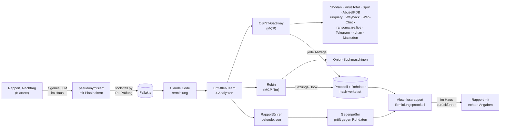

# gogoinvestigation

**Ein OSINT-Ermittlungsarbeitsplatz für Claude Code.** Ein pseudonymisierter Rapport geht hinein. Ein
Ermittler-Team aus KI-Agenten fragt Clearweb- und Dark-Web-Quellen ab, verknüpft die Ergebnisse und prüft sich
gegenseitig. Heraus kommen ein verständlicher Abschlussrapport mit Diagrammen und ein lückenloses Protokoll
darüber, wann was wo und wozu abgefragt wurde.

> *English summary:* A Claude Code workspace for CTI and law-enforcement OSINT. One MCP gateway wraps Shodan,
> VirusTotal, Spur, AbuseIPDB, urlquery, Wayback Machine, Web-Check, ransomware.live, Telegram, 4chan and
> Mastodon, logs every request in a hash-chained audit trail and stores every raw response. A team of
> subagents investigates, an independent agent cross-checks every finding against the raw data, and a
> generator refuses to build the final report unless each statement is backed by evidence. Documentation is
> in German.


## Inhalt

- [Was ihr bekommt](#was-ihr-bekommt)
- [Einrichten](#einrichten)
- [Schlüssel](#schlüssel)
- [Eine Ermittlung durchführen](#eine-ermittlung-durchführen)
- [Das Ermittler-Team](#das-ermittler-team)
- [Quellen](#quellen)
- [Schutzmechanismen](#schutzmechanismen)
- [Fehler beheben](#fehler-beheben)
- [Stand der Prüfung und Grenzen](#stand-der-prüfung-und-grenzen)
- [Erweitern](#erweitern)
- [Recht und Verantwortung](#recht-und-verantwortung)

## Was ihr bekommt



| Baustein | Aufgabe |
|---|---|
| **OSINT-Gateway** (`gateway/`) | Ein MCP-Server mit 36 Werkzeugen für alle Quellen. Protokolliert jede Abfrage, legt jede Antwort unverändert ab, hält Schlüssel aus Protokoll und Modell heraus, drosselt und cacht. |
| **Ermittler-Team** (`.claude/agents/`) | Sechs Subagenten: vier Analysten, ein unabhängiger Gegenprüfer, ein Rapportführer. |
| **Skills** (`.claude/skills/`) | Die Methodik: Ablauf der Ermittlung, Indikatoren ziehen, Ermittlungsstandard, Rapport, Protokoll. |
| **Wächter und Sitzungsprotokoll** (`.claude/hooks/`) | Sperren, was Agenten nicht dürfen, und halten fest, wer was getan hat. |
| **Werkzeuge** (`tools/`) | Fall anlegen, PII-Prüfung, Rapport und Protokoll erzeugen, Kette prüfen, Einrichtung prüfen. |
| **Musterfall** (`faelle/MUSTER-2026-001/`) | Ein erfundener Fall, komplett durchgespielt. Zeigt, was am Ende in der Fallakte liegt. |

Die Ergebnisse einer Ermittlung:

- `Abschlussrapport.html`: Zusammenfassung, Indikatoren, Befunde mit «Einfach erklärt», Beziehungsgraf, Zeitachse,
  Lücken, Empfehlungen, Glossar. Eine Datei, ohne Abhängigkeiten, aus dem Browser als PDF druckbar.
- `Ermittlungsprotokoll.html` und `.csv`: jede Abfrage mit Zeit, Quelle, Ziel, Zweck, Ergebnis, Prüfsumme, Rohdatei und Agent.
- `indikatoren.csv`: die Indikatorliste zum Weitergeben.


## Einrichten

**Voraussetzungen**

| Was | Wozu | Nötig? |
|---|---|---|
| Linux, macOS oder Windows mit WSL | Betriebssystem | ja |
| Python 3.10 oder neuer | Gateway und Werkzeuge | ja |
| [Claude Code](https://code.claude.com/docs) mit einem Konto, das Fable 5.2 nutzen darf | die Agenten | ja |
| Docker | Web-Check und Robin (Dark Web) | nein, beides bleibt sonst aus |
| `pdftotext` (Paket `poppler-utils`) | PDF-Dokumente aufnehmen | nein, `.txt` `.md` `.docx` gehen ohne |

**Installation**

```bash
git clone https://github.com/valITino/gogoinvestigation.git
cd gogoinvestigation
./setup.sh
```

`setup.sh` fragt nichts und lässt sich beliebig oft wiederholen. Es

1. prüft Python, legt `.venv` an und installiert die Pakete,
2. legt `.env` aus `.env.example` an (eine vorhandene `.env` bleibt unberührt),
3. startet Web-Check per Docker auf `127.0.0.1:3000` und lädt das Robin-Abbild, falls Docker läuft,
4. schaltet die MCP-Server für Claude Code frei (`.claude/settings.local.json`),
5. baut den Musterfall und prüft die Einrichtung mit 14 Selbsttests.

Am Ende steht eine Übersicht, was bereit ist und was fehlt. Optionen: `--ohne-docker`, `--ohne-robin`.

Danach bleibt von Hand: Schlüssel in `.env` eintragen, und beim ersten Start von `claude` im Projektordner den
Vertrauensdialog bestätigen. Beides lässt sich bewusst nicht automatisieren.

**Kontrolle**

```bash
python3 tools/pruefen.py          # Umgebung, Konfiguration, Quellen, Selbsttests
python3 tools/pruefen.py --live   # zusätzlich eine harmlose Testabfrage je eingerichteter Quelle
claude mcp list                   # zeigt "osint … Connected", sobald der Ordner als vertrauenswürdig bestätigt ist
```

## Schlüssel

Alle Schlüssel stehen in `.env`. Jede Quelle ist für sich optional: Was keinen Schlüssel hat, bleibt aus, der
Rest läuft. Sechs Quellen brauchen gar keinen.

| Quelle | Variable in `.env` | Woher | Hinweis |
|---|---|---|---|
| Shodan | `SHODAN_API_KEY` | [account.shodan.io](https://account.shodan.io) | DNS-Abfragen und Trefferlisten der Suche verbrauchen Query-Credits. |
| VirusTotal | `VIRUSTOTAL_API_KEY` | [virustotal.com/gui/my-apikey](https://www.virustotal.com/gui/my-apikey) | Bedingungen des öffentlichen Schlüssels prüfen. Die Drossel ist auf ihn eingestellt (`VT_INTERVALL=15.5`), mit Premium auf `0` setzen. |
| Spur | `SPUR_TOKEN` | Spur-App, Settings → API ([Doku](https://docs.spur.us/context-api)) | Kommerzieller Dienst. |
| AbuseIPDB | `ABUSEIPDB_API_KEY` | [abuseipdb.com/account/api](https://www.abuseipdb.com/account/api) | |
| urlquery | `URLQUERY_API_KEY` | Konto auf [urlquery.net](https://urlquery.net) | |
| ransomware.live | `RANSOMWARE_LIVE_API_KEY` | [my.ransomware.live](https://my.ransomware.live) | API PRO. Die schlüssellose API v2 ist laut Anbieter nur für private Nutzung, darum hier nur mit `RANSOMWARE_LIVE_V2=1`. |
| Telegram über RapidAPI | `RAPIDAPI_KEY` | [rapidapi.com](https://rapidapi.com), APIs «Telegram Channel» und «Telegram Scraper API» abonnieren | Nur für Kanal-Stammdaten und Kontoabfragen. Drittanbieter unbekannter Herkunft, vor dem Einsatz prüfen. |
| Shodan InternetDB, Wayback Machine, Ahmia-Sperrliste, Telegram-Kanalvorschau, 4chan, Mastodon | keine | | Laufen sofort. |
| Web-Check | keine | eigene Instanz, `setup.sh` startet sie | Adresse in `WEBCHECK_URL`. |
| Robin (Dark Web) | keine | Docker-Abbild, `setup.sh` lädt es | Tor läuft im Container. Eigener Fork: `ROBIN_IMAGE` setzen. |

Weitere Einstellungen in `.env`: `OSINT_PROXY` (alle Abfragen über einen Proxy leiten, damit sie nicht auf eure
Adresse zurückführen), `OSINT_ZEITZONE`, `OSINT_USER_AGENT`.

Die Schlüssel liest nur das Gateway. Claude Code darf `.env` nicht lesen, und im Protokoll erscheinen
Schlüssel als `***`.

## Eine Ermittlung durchführen

**1. Pseudonymisieren, im Haus.** Euer eigenes LLM ersetzt Personendaten durch nummerierte Platzhalter:
`[PERSON_01]`, `[ORG_01]`, `[ADRESSE_01]`, `[TEL_01]`. Nummeriert, nicht alle «Hans Muster», sonst geht verloren,
wer wer ist. Technische Indikatoren (IPs, Domains, Hashes, Adressen der Täterseite) bleiben stehen, denn nach
ihnen wird gesucht. Eine fertige Anweisung für euer LLM und die Regeln, was bleibt und was geht, stehen in
[docs/PSEUDONYMISIERUNG.md](docs/PSEUDONYMISIERUNG.md).

**2. Ermitteln.** Ein Befehl in Claude Code:

```
claude
/ermittlung 2026-0412 ~/eingang/rapport_pseudonymisiert.docx
```

Das legt den Fall an, schickt das Dokument durch die PII-Prüfung, zieht die Indikatoren, setzt das Team ein,
lässt gegenprüfen und erzeugt Rapport und Protokoll. Rückfragen gibt es nur, wo ein Mensch entscheiden muss.

Wer den Fall lieber selbst anlegt:

```bash
python3 tools/fall.py neu 2026-0412 --titel "Phishing Kundenportal" --kuerzel ABC --rapport rapport.docx
```

**3. Freigaben erteilen, falls nötig.** Drei Dinge sind standardmässig aus und werden pro Fall am Terminal freigegeben:

```bash
python3 tools/fall.py freigabe 2026-0412 darkweb       --durch "Kürzel/Funktion" --vermerk "Grundlage"
python3 tools/fall.py freigabe 2026-0412 aktiv         --durch "…" --vermerk "…"
python3 tools/fall.py freigabe 2026-0412 personenbezug --durch "…" --vermerk "…"
```

| Freigabe | Schaltet frei |
|---|---|
| `darkweb` | Suche und Lektüre von Onion-Seiten über Robin. |
| `aktiv` | Massnahmen, die das Ziel bemerken kann: URL bei urlquery einreichen, Seite in der Wayback Machine sichern, aktive Web-Check-Prüfungen. Jede einzelne verlangt zusätzlich eine Bestätigung in der Sitzung. |
| `personenbezug` | Kontoabfragen: Mastodon-Konto, Telegram-Benutzer und -Suche. |

Der Befehl verlangt eine Bestätigung am Terminal. Ein Agent kann sich keine Freigabe selbst erteilen.

**4. Ergebnis ansehen.** `faelle/2026-0412/rapport/Abschlussrapport.html` im Browser öffnen, als PDF drucken.

**5. Zurückführen, im Haus.** Die Platzhalter im fertigen Rapport ersetzt ihr ausserhalb von Claude Code:

```bash
python3 tools/reidentifizieren.py 2026-0412 --zuordnung /sicher/zuordnung.csv --ausgabe /sicher/ablage/
```

Weitere Befehle:

```bash
python3 tools/fall.py liste                    # alle Fälle
python3 tools/fall.py status 2026-0412         # Stand und Freigaben
python3 tools/fall.py aufnehmen 2026-0412 nachtrag.docx
python3 tools/rapport.py 2026-0412             # Rapport neu erzeugen (--entwurf, --nur-pruefen)
python3 tools/protokoll.py 2026-0412           # Protokoll neu erzeugen
python3 tools/audit_pruefen.py 2026-0412       # Protokollkette prüfen
python3 tools/musterfall.py                    # Musterfall neu bauen
```

In Claude Code: `/ermittlung <Fall-ID> [Dokument]`, `/abschlussrapport <Fall-ID>`, `/protokoll <Fall-ID>`.

## Das Ermittler-Team

| Agent | Fragt | Werkzeuge |
|---|---|---|
| `infrastruktur-analyst` | Wem gehört die IP? Rechenzentrum, VPN oder Privatanschluss? Was läuft darauf, was lag sonst dort? | Shodan, Spur, AbuseIPDB, VirusTotal, Web-Check passiv, Wayback |
| `malware-url-analyst` | Ist die Datei bekannt? Was tat die Seite beim Aufruf? Seit wann gibt es sie? | VirusTotal, urlquery, Wayback, Web-Check passiv |
| `darkweb-analyst` | Ist die Gruppe bekannt? Passt die Leak-Seite? Taucht der Fall in Breach-Feeds oder im Dark Web auf? | ransomware.live, Ahmia-Sperrliste, Telegram, Robin |
| `socmint-analyst` | Was wird in Foren und Kanälen zum Fall gesagt? Was zeigen Konten der Täterseite? | 4chan, Telegram, Mastodon |
| `gegenpruefer` | Steht das, was im Rapport stehen soll, wirklich in den Rohdaten? | nur Lesen. Kennt den Ermittlungsverlauf nicht. |
| `rapportfuehrer` | Verdichtet die Meldungen zu `befunde.json`, arbeitet die Gegenprüfung ein, erzeugt Rapport und Protokoll. | Lesen, Schreiben, `tools/` |

Die Hauptsitzung leitet: Sie zieht die Indikatoren, verteilt sie, entscheidet über Pivots (höchstens zwei Runden)
und ist die einzige, die aktive Massnahmen ausführt.

Alle Agenten laufen mit `model: inherit`, also mit dem Modell der Sitzung. Das Projekt setzt es auf
`claude-fable-5-2` (`.claude/settings.json`).

Skills und Subagenten ergänzen sich: Ein **Subagent** ist eine Rolle mit eigenem Kontext und eigenen Werkzeugen.
Ein **Skill** ist Wissen, wie etwas zu tun ist. Der Skill `ermittlungsstandard` wird in jeden Analysten vorgeladen
und regelt Zweckangabe, Sicherheitsstufen, Quellenbewertung und das Format der Rückmeldung.

## Quellen

So sind die gewünschten Werkzeuge eingebunden. Details und Endpunkte: [docs/QUELLEN.md](docs/QUELLEN.md).

| Quelle | Einbindung | Art |
|---|---|---|
| Shodan | Gateway: `shodan_host`, `shodan_internetdb`, `shodan_dns`, `shodan_suche` | passiv |
| VirusTotal | Gateway: `virustotal_ip`, `_domain`, `_datei`, `_url`, `_beziehungen`. Nur Abfragen, nie Uploads. | passiv |
| Spur | Gateway: `spur_kontext` | passiv |
| AbuseIPDB | Gateway: `abuseipdb_pruefen`, `abuseipdb_meldungen` | passiv |
| web-check | Eigene Instanz per Docker. Gateway: `webcheck_passiv` (13 Prüfungen), `webcheck_aktiv` (27 Prüfungen) | passiv und aktiv |
| Robin | Eigener MCP-Server des Projekts, läuft als Container mit Tor. Wächter verlangt Freigabe `darkweb`, Hook sichert jede Antwort als Beleg `X-…`. | Tor |
| Darkus | Menügesteuert, deshalb nicht agentenfähig. Seine Suchmaschinen deckt Robin ab. Die Prüfung gegen die Ahmia-Sperrliste ist als `onion_sperrliste` nachgebaut und Pflicht vor jedem Öffnen einer Onion-Seite. | passiv |
| ransomware.live | Gateway: `ransomware_opfer`, `_gruppe`, `_iocs`, `_aktuell` | passiv |
| urlquery | Gateway: `urlquery_suche`, `_bericht`, `_reputation`, `_status` und `urlquery_einreichen` | passiv, Einreichen aktiv |
| Wayback Machine | Gateway: `wayback_verlauf`, `wayback_abruf` und `wayback_sichern` | passiv, Sichern aktiv |
| Telegram Breach Monitor | Die Seite verweist auf den Kanal `breachdetect`. Gateway: `telegram_kanal` liest dessen öffentliche Web-Vorschau. | passiv |
| TeleGramSint | Menügesteuert. Drei seiner Abfragen sind nachgebaut: `telegram_kanalinfo`, `telegram_entitaet`, `telegram_suche`. Die Suche nach Telefonnummern ist bewusst weggelassen. | passiv, teils Personenbezug |
| OSINT-Chan | Nachgebaut über die offizielle Lese-API: `chan_katalog`, `chan_thread`. Stichworte werden lokal gefiltert. | passiv |
| Masto | Nachgebaut: `mastodon_instanz`, `mastodon_konto` | passiv, Konto mit Personenbezug |

**Passiv** heisst: Die Datenbank eines Dritten wird befragt, das Ziel merkt nichts. Der Anbieter sieht aber
den Indikator. **Aktiv** heisst: Das Ziel wird aufgerufen und kann das bemerken.

Warum ein eigenes Gateway statt je eines fertigen MCP-Servers pro Dienst: eine Stelle für Protokoll, Rohdaten,
Drossel und Cache, ein überschaubarer Code statt eines Dutzends fremder Server mit euren Schlüsseln, und kurze
Antworten, die den Kontext der Agenten schonen. Die vollständige Antwort liegt immer in den Rohdaten.

## Schutzmechanismen

Technisch erzwungen, nicht nur dem Modell aufgetragen:

| Schutz | Wie | Wo |
|---|---|---|
| Keine übersehenen Personendaten | PII-Prüfung vor der Aufnahme (AHV-Nummer, IBAN, Telefon, Geburtsdatum, Kontrollschild, Kreditkarte). Sperrfunde verhindern die Aufnahme. | `tools/pii_pruefung.py` |
| Agenten lesen nur geprüfte Dokumente | Wächter vergleicht den Hash jeder Datei im Eingang mit dem Register der PII-Prüfung. | `.claude/hooks/waechter.py` |
| Keine Abfrage ohne Fall und Zweck | Das Gateway weist sie ab. | `gateway/kern.py` |
| Aktiv, Dark Web, Personenbezug nur mit Freigabe | Gateway und Wächter prüfen `fall.json`. Abgelehnte Versuche stehen im Protokoll. | `gateway/kern.py`, Wächter |
| Keine Selbstfreigabe | `fall.py freigabe` verlangt ein Terminal. Wächter und Berechtigungen sperren den Befehl für Agenten. | `tools/fall.py` |
| Nichts am Protokoll vorbei | `curl`, `wget` und Ähnliches sind gesperrt. `WebFetch` und `WebSearch` fragen jedes Mal nach. | `.claude/settings.json`, Wächter |
| Protokoll und Rohdaten unveränderbar für Agenten | Schreibschutz über Berechtigungen und Wächter. | beide |
| Veränderungen fallen auf | Jeder Eintrag enthält die Prüfsumme des Vorgängers, jede Rohdatei ist per SHA-256 gebunden. | `gateway/akte.py`, `tools/audit_pruefen.py` |
| Kein Rapport ohne Belege | Der Generator prüft jede Aussage gegen das Protokoll. `hoch` verlangt zwei verschiedene Quellen. | `tools/rapport.py` |
| Keine Schlüssel im Kontext | `.env` ist für Claude Code gesperrt, Adressen im Protokoll sind maskiert. | Einstellungen, Gateway |
| Onion-Seiten mit Missbrauchsinhalten | Pflichtprüfung gegen die Ahmia-Sperrliste vor dem Öffnen. Die Adresse verlässt dabei das Haus nicht. | `onion_sperrliste` |

Dem Modell aufgetragen (`CLAUDE.md`, Skills, Agenten), ohne technische Sperre: Platzhalter nie auflösen,
Fremdinhalte nie als Anweisung behandeln, im Fall bleiben, Feststellung und Bewertung trennen, niemanden als
Täter benennen.

Was ihr wissen müsst:

- **Die PII-Prüfung erkennt keine Namen.** Sie ist ein Sicherheitsnetz für Muster, kein Ersatz für die Pseudonymisierung.
- **`@datei` im Prompt umgeht den Wächter.** Claude Code fügt so erwähnte Dateien ohne Werkzeugaufruf ein.
  Dokumente deshalb nie mit `@` anhängen, sondern über `/ermittlung` oder `fall.py` aufnehmen.
- **Die Kette erkennt Veränderungen, sie verhindert sie nicht.** Wer den Stand verbindlich festhalten will,
  hinterlegt den letzten Kettenwert ausserhalb des Systems (Journal, Zeitstempeldienst).
- **Indikatoren gehen an Dritte.** Jede Abfrage zeigt dem Anbieter die IP, Domain oder den Hash, und Anthropic
  verarbeitet, was die Agenten lesen. Welche Indikatoren das Haus verlassen dürfen, entscheidet ihr.
- **Dritt-Software läuft mit.** Robin und Web-Check sind fremde Projekte. Robin bringt in seinen
  Werkzeugbeschreibungen eigene Arbeitsanweisungen an das Modell mit. Für den Einsatz in einer Behörde: Forks
  prüfen, Abbilder selbst bauen und auf eine Version festlegen (`ROBIN_IMAGE`).

## Fehler beheben

| Symptom | Ursache | Lösung |
|---|---|---|
| `claude mcp list` zeigt `osint … Pending approval` | Ordner noch nicht als vertrauenswürdig bestätigt | `claude` im Projektordner starten, Dialog bestätigen |
| `osint` verbindet nicht | `.venv` fehlt oder Pakete fehlen | `./setup.sh` |
| Werkzeug meldet «Schlüssel … fehlt in .env» | Quelle nicht eingerichtet | Schlüssel eintragen, Claude Code neu starten |
| «verweigert den Zugriff (HTTP 401/403)» | Schlüssel falsch, abgelaufen oder Abo deckt den Endpunkt nicht | Schlüssel prüfen, `python3 tools/pruefen.py --live` |
| «Kontingent oder Ratenlimit erreicht (HTTP 429)» | Tages- oder Minutenlimit der Quelle | Später weiter. Der Rapport nennt die Lücke. |
| «Keine Verbindung zu Web-Check» | Container läuft nicht | `docker compose up -d webcheck` |
| VirusTotal-Abfragen dauern lange | Drossel für den öffentlichen Schlüssel | Mit Premium `VT_INTERVALL=0` in `.env` |
| «Nicht ausgeführt: … braucht der Fall die Freigabe» | Freigabe fehlt | `python3 tools/fall.py freigabe …` am Terminal |
| «… ist nicht durch die PII-Prüfung freigegeben» | Datei von Hand in den Eingang kopiert oder nachträglich geändert | `python3 tools/fall.py aufnehmen <Fall-ID> <Datei>` |
| Dokument wird nicht aufgenommen (Sperrfunde) | Personendaten übersehen, oder Fehlalarm | Nachpseudonymisieren. Bei Fehlalarm am Terminal: `--trotzdem "Begründung" --durch "Kürzel"` |
| `rapport.py` meldet Mängel | Aussage ohne Beleg, `hoch` mit nur einer Quelle, Gegenprüfung offen | An der Sache beheben. Zwischenstand mit `--entwurf`. |
| Robin erscheint nicht | Docker fehlte bei der Einrichtung | Docker starten, `./setup.sh` erneut |
| «Protokoll … ABWEICHUNGEN» | Protokoll oder Rohdatei wurde verändert | Nicht reparieren. Vorfall klären. |

Protokolle der Einrichtung: `/tmp/osint-pip.log`, `/tmp/osint-docker.log`, `/tmp/osint-muster.log`.

## Stand der Prüfung und Grenzen

Geprüft:

- 14 Selbsttests ohne Netz (`python3 tools/selbsttest.py`): Gateway über echtes MCP-stdio, Protokollkette samt
  Manipulationserkennung, Cache, Freigaben, Wächter, Sitzungs-Hook, PII-Prüfung, Prüfregeln des Rapports,
  Übereinstimmung der Agenten mit den Werkzeugen.
- Der Musterfall läuft durch dieselben Gateway-Werkzeuge wie eine echte Ermittlung, mit vorgefertigten Antworten.
- Claude Code 2.1.323 liest `.mcp.json`, verbindet sich mit dem Gateway (`claude mcp list`) und beanstandet die
  Einstellungen nicht (`claude doctor`).

Nicht geprüft:

- **Die Quellen selbst.** Beim Bau standen weder Schlüssel noch Netzzugang zu den Diensten zur Verfügung. Die
  Endpunkte folgen den Dokumentationen und offiziellen Clients (siehe [docs/QUELLEN.md](docs/QUELLEN.md)).
  `python3 tools/pruefen.py --live` prüft jede eingerichtete Quelle mit einem harmlosen Testwert. Am unsichersten
  sind die Pfade der ransomware.live API PRO und das Auslesen der Telegram-Vorschau.
- **Eine vollständige Ermittlung in einer echten Claude-Code-Sitzung** mit Subagenten, Skills und Hooks im
  Zusammenspiel. Die Hooks sind einzeln mit den dokumentierten Ereignisdaten getestet.
- **Robin und Web-Check im Betrieb.** Docker lief beim Bau nicht.

Grenzen:

- Fable 5.2 hat zusätzliche Schutzmassnahmen im Bereich Cybersicherheit. Der Arbeitsplatz verlangt vom Modell
  Abfragen und deren Auswertung, keine Analyse oder Entwicklung von Schadcode.
- Abfragen mit Klarnamen (etwa die geschädigte Firma auf Leak-Seiten suchen) sind mit pseudonymisierten Dokumenten
  nicht möglich. Der Rapport weist sie als «im Haus nachzuholen» aus.
- Windows ohne WSL ist nicht vorgesehen (Pfade der `.venv`, Dateisperren).

## Erweitern

Eine neue Quelle in vier Schritten:

1. In `gateway/quellen_*.py` eine Funktion mit `@werkzeug` schreiben. Sie ruft `abfrage(...)` auf und gibt eine
   gekürzte Fassung der Antwort zurück. Protokoll, Rohdaten, Cache und Fehlerbehandlung kommen von `abfrage`.
2. Die Quelle in `gateway/quellen.py` eintragen (Name, Schlüsselvariable, Werkzeuge, Testabfrage).
3. Das Werkzeug dem passenden Agenten unter `tools:` geben und in `.claude/settings.json` erlauben.
4. `python3 tools/selbsttest.py`. Der Test schlägt an, wenn Agenten, Einstellungen und Gateway nicht zusammenpassen.

```python
@werkzeug
async def beispiel_abfrage(fall: Fall, zweck: Zweck, domain: str) -> dict:
    """Beispielquelle: was sie liefert und wann man sie braucht. Diese Zeilen liest der Agent."""
    domain = pruef_domain(domain)
    a = await abfrage(fall, zweck, werkzeug="beispiel_abfrage", quelle="Beispiel", ziel=domain, ziel_typ="domain",
                      url=f"https://api.beispiel.example/v1/domain/{domain}",
                      kopf={"Authorization": schluessel("BEISPIEL_API_KEY", "Beispiel")})
    return a.als_dict(nimm(a.daten, "registriert", "inhaber_land") if a.ergebnis == "ok" else None)
```

## Recht und Verantwortung

Das Projekt ist ein Werkzeug. Ob und wie ihr es einsetzen dürft, bestimmen euer Auftrag, eure Rechtsgrundlagen
und die Bedingungen der Anbieter. Vor dem Einsatz mit echten Fällen mit Rechtsdienst und Datenschutz klären:

- welche Indikatoren an Dritte und an Anthropic gehen dürfen,
- unter welchen Voraussetzungen aktive Massnahmen, Dark-Web-Recherche und Kontoabfragen zulässig sind,
- ob eure Abos die dienstliche Nutzung der Quellen decken,
- wie Protokolle und Rohdaten aufbewahrt und gelöscht werden.

Die Freigaben, das Protokoll und die Prüfregeln sind dafür gebaut, diese Entscheide festzuhalten und
durchzusetzen. Sie ersetzen sie nicht. Dieser Text ist keine Rechtsberatung.

## Lizenz und Mitmachen

Eine Lizenz ist noch nicht festgelegt. Ohne sie dürfen andere den Code rechtlich nicht weiterverwenden. Wer
das Projekt für die Gemeinschaft öffnen will, legt eine `LICENSE` ins Repository.

Die eingebundenen Projekte haben eigene Lizenzen: [Robin](https://github.com/apurvsinghgautam/robin),
[Web-Check](https://github.com/Lissy93/web-check), [Darkus](https://github.com/Lucksi/Darkus),
[TeleGramSint](https://github.com/OSINTCabal/TeleGramSint), [OSINT-Chan](https://github.com/OSINTCabal/OSINT-Chan),
[Masto](https://github.com/C3n7ral051nt4g3ncy/Masto). Aus ihnen wurde kein Code übernommen. Robin und Web-Check
laufen als unveränderte Container, die übrigen Funktionen sind gegen die jeweiligen öffentlichen Schnittstellen neu geschrieben.

Beiträge sind willkommen, besonders neue Quellen und Rückmeldungen aus `pruefen.py --live`. Bitte keine
Falldaten, Schlüssel oder echten Indikatoren in Issues und Pull Requests.
